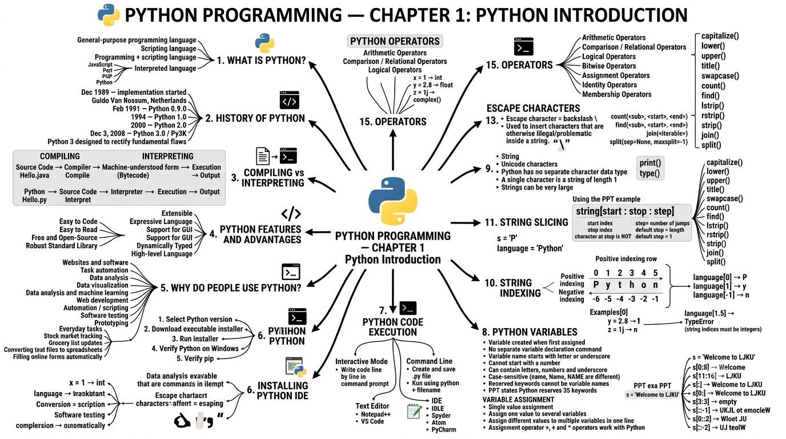

# LJ-Python-sem3-chapter1-explained

# 📘 PYTHON PROGRAMMING — CHAPTER 1

## Introduction to Python

**Primary source:** Uploaded _PPT Python ch1.pptx_. The PPT covers Python introduction, history, compilation vs interpretation, features, applications, installation, IDLE examples, execution methods, variables, strings, slicing, string methods, escape characters, type conversion, and operators.

---

# STEP 1 — DEEP EXPLANATION

## 1. Introduction to Python

### What is Python?

Python is a **general-purpose programming language** that is often used in **scripting roles**.

Therefore, according to the PPT:

- Python is a **programming language**.
    
- Python is also a **scripting language**.
    
- Python is called an **interpreted language**.
    

An interpreted language generally executes a program through an interpreter rather than first compiling the complete program directly into machine instructions.

Examples of interpreted languages mentioned in the PPT:

- JavaScript
    
- Perl
    
- PHP
    
- Python
    

### Simple understanding

Suppose you write:

```python
print("Hello")
```

Python allows you to write this instruction in a `.py` file and execute it using the Python interpreter.

### Exam Point ⭐

> **Python is a general-purpose, interpreted programming language that is also commonly used as a scripting language.**

---

# 2. History of Python

Python was created by **Guido Van Rossum**.

### Important Python history timeline

```text
December 1989
     │
     ▼
Implementation of Python started
by Guido Van Rossum
in the Netherlands
     │
     ▼
February 1991
Python 0.9.0 published
     │
     ▼
1994
Python 1.0 released
     │
     ▼
2000
Python 2.0 released
     │
     ▼
December 3, 2008
Python 3.0 / Py3K released
```

### Important dates

| Year/Date        | Event                            |
| ---------------- | -------------------------------- |
| December 1989    | Implementation of Python started |
| February 1991    | Python 0.9.0 published           |
| 1994             | Python 1.0 released              |
| 2000             | Python 2.0 released              |
| December 3, 2008 | Python 3.0 / Py3K released       |

The PPT states that Python 3.0 was designed to rectify fundamental flaws in the language.

### Exam Point ⭐

**Who started Python?**  
→ Guido Van Rossum

**When was Python implementation started?**  
→ December 1989

**When was Python 0.9.0 published?**  
→ February 1991

**When was Python 3.0 released?**  
→ December 3, 2008

---

# 3. Compiling and Interpreting Language

The PPT introduces two ways in which programming languages can be processed:

1. **Compilation**
    
2. **Interpretation**
    

---

## 3.1 Compiling Language

In a compiled approach, the source program is translated into a form that the machine can understand before execution.

Simplified process:

```text
Source Code
    │
    ▼
Compiler
    │
    ▼
Machine/Executable Form
    │
    ▼
Execute
    │
    ▼
Output
```

The PPT gives a Java-style example:

```text
Hello.java
   │
   ▼
 compile
   │
   ▼
Hello.class
   │
   ▼
 execute
   │
   ▼
 Output
```

---

## 3.2 Interpreting Language

Python is presented in the PPT as an interpreted language.

The simplified process is:

```text
Python Source Code
       │
       ▼
    Interpreter
       │
       ▼
    Execution
       │
       ▼
     Output
```

Example:

```text
Hello.py
   │
   ▼
 interpret
   │
   ▼
 output
```

---

## 3.3 Compiler vs Interpreter

|Compiler|Interpreter|
|---|---|
|Translates the program before execution|Interprets the program during execution|
|Produces a translated form before execution|Executes through interpretation|
|PPT example: Java|PPT example: Python|

### Exam Point ⭐

Remember the basic flow:

**Compiler:**

```text
Source → Compile → Translated form → Execute → Output
```

**Python/interpreter:**

```text
Source → Interpret → Output
```

---

# 4. Python Features and Advantages

The PPT lists the following Python features and advantages:

1. Easy to Code and Easy to Read
    
2. Free and Open-Source
    
3. Robust Standard Library
    
4. Interpreted
    
5. Portable
    
6. Object-Oriented and Procedure-Oriented
    
7. Extensible
    
8. Expressive Language
    
9. Support for GUI
    
10. Dynamically Typed
    
11. High-level Language
    

Let's understand each.

---

## 4.1 Easy to Code and Easy to Read

Python syntax is comparatively simple and readable.

Example:

```python
print("Hello World")
```

The instruction is easy to understand.

### Exam Point

Python is considered easy to learn partly because its syntax is simple and readable.

---

## 4.2 Free and Open-Source

Python is available without requiring users to purchase the language itself.

Its source code is also available as open-source software.

---

## 4.3 Robust Standard Library

Python provides a large collection of standard libraries that can be used for different programming tasks.

This reduces the need to implement everything from the beginning.

---

## 4.4 Interpreted

Python is presented by the PPT as an interpreted language.

The interpreter processes Python programs for execution.

---

## 4.5 Portable

Python programs can be used across different operating systems/platforms with appropriate Python support.

For example, Python is available on:

```text
Windows
   │
Linux
   │
macOS
```

---

## 4.6 Object-Oriented and Procedure-Oriented

Python supports different programming approaches, including:

- Object-oriented programming
    
- Procedure-oriented programming
    

Therefore, Python can be used to structure programs using objects as well as procedures/functions.

---

## 4.7 Extensible

Python can be extended using additional functionality and components.

This allows programmers to expand what Python programs can do.

---

## 4.8 Expressive Language

Python allows programmers to express programming logic relatively concisely.

---

## 4.9 Support for GUI

Python supports development of **Graphical User Interfaces (GUI)**.

A GUI allows users to interact with software through elements such as:

```text
Buttons
Menus
Windows
Text boxes
```

---

## 4.10 Dynamically Typed

Python variables do not require a type declaration before assignment.

For example:

```python
x = 10
```

Later:

```python
x = "Python"
```

The variable can refer to a value of a different type.

The PPT specifically explains that variables do not need to be declared with a particular type and can change type when assigned a new value.

---

## 4.11 High-Level Language

Python is a **high-level programming language**.

It provides abstractions that make programming easier for humans compared with working directly with low-level machine instructions.

---

# 5. Why Do People Use Python?

According to the PPT, Python is commonly used for:

- Developing websites
    
- Developing software
    
- Task automation
    
- Data analysis
    
- Data visualization
    

---

# 6. What Can We Do With Python?

The PPT specifically lists five areas.

## 6.1 Data Analysis and Machine Learning

Python can be used for:

```text
Data
 │
 ▼
Analysis
 │
 ▼
Patterns / Information
```

It is also used in machine learning applications.

---

## 6.2 Web Development

Python can be used to develop websites and web-based software.

---

## 6.3 Automation or Scripting

Python can automate repetitive tasks.

For example, instead of manually performing the same operation repeatedly, a Python script can perform the task automatically.

---

## 6.4 Software Testing and Prototyping

Python can be used for:

- Software testing
    
- Creating prototypes
    

A prototype is an early version of a software solution used to explore or demonstrate an idea.

---

## 6.5 Everyday Tasks

The PPT gives examples such as:

- Keeping track of stock market information
    
- Updating a grocery shopping list
    
- Converting text files to spreadsheets
    
- Filling out online forms automatically
    

### Exam Point ⭐

Remember the five categories:

```text
Python Applications
│
├── Data Analysis & Machine Learning
├── Web Development
├── Automation / Scripting
├── Software Testing & Prototyping
└── Everyday Tasks
```

---

# 7. Installing Python IDE

The PPT gives the following installation procedure.

### Step 1 — Select Version of Python to Install

Choose the appropriate Python version.

### Step 2 — Download Python Executable Installer

Download the executable installer.

### Step 3 — Run Executable Installer

Run the downloaded installer.

### Step 4 — Verify Python is Installed on Windows

After installation, verify that Python is correctly installed.

### Step 5 — Verify Pip Was Installed

Check whether **pip** was installed.

### Flow

```text
Select Python Version
        │
        ▼
Download Installer
        │
        ▼
Run Installer
        │
        ▼
Verify Python
        │
        ▼
Verify pip
```

### Exam Point ⭐

The PPT gives **5 installation/verification steps**.

---

# 8. Sample Code on IDLE

The PPT demonstrates basic Python commands using IDLE.

### Printing a string

```python
>>> print('Hello, World!')
Hello, World!
```

### Printing an integer

```python
>>> print(1)
1
```

### Printing a floating-point number

```python
>>> print(2.2)
2.2
```

### Printing another string

```python
>>> print('Abc@123')
Abc@123
```

---

## Using `type()`

The `type()` function identifies the type/class of a value.

Example:

```python
>>> type('Hello, World!')
<class 'str'>
```

Therefore:

```text
'Hello, World!' → str
```

Another example:

```python
>>> type(1)
<class 'int'>
```

So:

```text
1 → int
```

And:

```python
>>> type(2.2)
<class 'float'>
```

So:

```text
2.2 → float
```

### Important Data Types Demonstrated

|Example|Type|
|---|---|
|`'Hello, World!'`|`str`|
|`1`|`int`|
|`2.2`|`float`|

---

# 9. Python Program Execution

The PPT asks us to consider different ways of running a Python script.

It lists **four ways**:

1. Interactive Mode
    
2. Command Line
    
3. Text Editor
    
4. IDE
    

---

## 9.1 Interactive Mode

In Interactive Mode, code is entered in the command prompt **line by line**.

Example:

```text
>>> print("Hello")
Hello

>>> print(10)
10
```

This is useful when you want to execute small pieces of Python code immediately.

---

## 9.2 Command Line

First create a Python file and save it with the `.py` extension.

For example:

```text
program.py
```

Then run it from the command prompt using Python and the filename.

Conceptually:

```text
Python file
    │
    ▼
program.py
    │
    ▼
Command Prompt
    │
    ▼
Python + filename
    │
    ▼
Output
```

---

## 9.3 Text Editor

Python programs can be written using text editors.

The PPT gives examples:

- Notepad++
    
- VS Code
    

---

## 9.4 IDE

An **IDE (Integrated Development Environment)** provides an environment for writing and working with programs.

Examples mentioned in the PPT:

- IDLE
    
- Spyder
    
- Atom
    
- PyCharm
    

---

# 10. Python Variables

A variable is a name used to refer to a value.

Example:

```python
x = 10
```

Here:

```text
x  → variable name
10 → value
```

---

# 11. Rules for Creating Variables in Python

The PPT provides several rules.

### Rule 1 — Must start with a letter or underscore

Valid:

```python
name = "Python"
_age = 20
```

---

### Rule 2 — Cannot start with a number

Invalid:

```python
1name = "Python"
```

A variable name cannot begin with a number.

---

### Rule 3 — Allowed characters

A variable name can contain:

- Alphabetic characters
    
- Numbers
    
- Underscore `_`
    

According to the PPT:

```text
A-Z
a-z
0-9
_
```

---

### Rule 4 — Variable names are case-sensitive

These are different:

```python
name
Name
NAME
```

Python treats them as separate variable names.

---

### Rule 5 — Reserved words cannot be used as variable names

Python has reserved **keywords** that cannot be used for naming variables.

The PPT states that Python reserves **35 keywords**.

### Exam Point ⭐

Remember:

```text
Variable Naming Rules
│
├── Start with letter or _
├── Cannot start with number
├── Can contain A-Z, a-z, 0-9, _
├── Case-sensitive
└── Keywords cannot be used
```

---

# 12. Something New About Python Variables

Python has some important characteristics concerning variables.

## 12.1 No Separate Variable Declaration

Python does not require a separate command for declaring a variable.

You simply assign a value:

```python
x = 10
```

---

## 12.2 Variable Is Created During Assignment

A variable is created when a value is assigned to it.

```python
x = 10
```

At this point, `x` is created.

---

## 12.3 Variables Do Not Need a Fixed Type Declaration

Python does not require you to specify the variable's type beforehand.

For example:

```python
x = 10
```

Later:

```python
x = "Hello"
```

The same variable can refer to a value of a different type.

---

## 12.4 Assigning One Value to Multiple Variables

Python allows assigning a single value to several variables.

Conceptually:

```python
a = b = c = 10
```

All three variables receive the value `10`.

```text
a ──┐
b ──┼──► 10
c ──┘
```

---

## 12.5 Assigning Different Values to Multiple Variables

Python also allows different values to be assigned in a single statement.

For example:

```python
a, b, c = 10, 20, 30
```

Conceptually:

```text
a ──► 10
b ──► 20
c ──► 30
```

The PPT also notes the use of `+` and `*` operators with Python variables.

---

# 13. Strings in Python

A **string** represents text.

Examples:

```python
s = 'P'
language = 'Python'
```

Then:

```python
print(s)
```

produces:

```text
P
```

And:

```python
print(language)
```

produces:

```text
Python
```

Both are of type `str`.

---

## Definition of String

The PPT states:

> Strings are arrays of bytes representing Unicode characters.

It also explains:

- Python does not have a separate character data type.
    
- A single character is simply a string with length 1.
    
- A string can contain a very large number of characters.
    

### Example

```python
x = 'P'
```

Here `x` is still a string:

```text
'P'
 ↓
str
```

It is not a separate `char` data type.

---

# 14. String Indexing

Characters in a string can be accessed using **square brackets `[]`**.

Consider:

```text
Python
```

Positive indexes:

```text
Character:  P   y   t   h   o   n
Index:      0   1   2   3   4   5
```

Negative indexes:

```text
Character:  P    y    t    h    o    n
Index:     -6   -5   -4   -3   -2   -1
```

---

## Example

```python
language = 'Python'
```

### Access index 1

```python
print(language[1])
```

Output:

```text
y
```

### Access index 0

```python
print(language[0])
```

Output:

```text
P
```

### Access last character

```python
print(language[-1])
```

Output:

```text
n
```

---

## Invalid String Index

The PPT shows:

```python
print(language[1.5])
```

This produces:

```text
TypeError: string indices must be integers
```

Why?

Because string indexes must be integer values.

Valid:

```python
language[1]
```

Invalid:

```python
language[1.5]
```

### Exam Point ⭐

> String indexing uses square brackets and integer indexes.

---

# 15. String Slicing

A **segment of a string is called a slice**.

Python uses the following syntax:

```python
string[start:stop:step]
```

---

## 15.1 `start`

`start` specifies the index from which slicing begins.

Default:

```text
0
```

---

## 15.2 `stop`

`stop` specifies where slicing stops.

**The character at the `stop` index is not included.**

The default value is the length of the string.

---

## 15.3 `step`

`step` specifies how many positions are jumped while moving through the string.

Default:

```text
1
```

---

### Important formula

```text
string[start : stop : step]
```

Think:

```text
START → where to begin
STOP  → where to stop (excluded)
STEP  → how many positions to jump
```

---

# 16. String Slicing Examples

The PPT uses:

```python
s = 'Welcome to LJKU'
```

---

## `s[0:8]`

```python
print(s[0:8])
```

Output:

```text
Welcome
```

The stop index `8` itself is excluded.

---

## `s[11:16]`

```python
print(s[11:16])
```

Output:

```text
LJKU
```

---

## `s[:]`

```python
print(s[:])
```

Output:

```text
Welcome to LJKU
```

This selects the complete string.

---

## `s[0:]`

```python
print(s[0:])
```

Output:

```text
Welcome to LJKU
```

The starting position is explicitly `0`.

---

## `s[3:3]`

```python
print(s[3:3])
```

This produces an empty slice because the start and stop positions are the same.

---

## Reverse String

The PPT demonstrates:

```python
print(s[::-1])
```

Output:

```text
UKJL ot emocleW
```

This uses a negative step to traverse the string backward.

---

## Every Second Character

```python
print(s[0::2])
```

Output:

```text
Wloet JU
```

---

## Reverse With Step `-2`

```python
print(s[::-2])
```

Output:

```text
UJ teolW
```

### Exam Point ⭐

The three most important slicing concepts:

```text
[start : stop : step]
```

- Start → beginning index
    
- Stop → ending boundary, excluded
    
- Step → jump size
    

---

# 17. String Methods

The PPT lists the following string methods:

|Method|Purpose|
|---|---|
|`capitalize()`|Capitalizes the string|
|`lower()`|Converts to lowercase|
|`upper()`|Converts to uppercase|
|`title()`|Converts text to title case|
|`swapcase()`|Swaps uppercase/lowercase|
|`count()`|Counts occurrences|
|`find()`|Finds a substring|
|`lstrip()`|Removes leading whitespace|
|`rstrip()`|Removes trailing whitespace|
|`strip()`|Removes leading and trailing whitespace|
|`join()`|Joins iterable elements|
|`split()`|Splits a string|

The PPT specifically lists optional parameters for `count()` and `find()`, and parameters for `join()` and `split()`.

---

## Important Syntax

### `capitalize()`

```python
string.capitalize()
```

### `lower()`

```python
string.lower()
```

### `upper()`

```python
string.upper()
```

### `title()`

```python
string.title()
```

### `swapcase()`

```python
string.swapcase()
```

### `count()`

```python
string.count(sub, start, end)
```

### `find()`

```python
string.find(sub, start, end)
```

### Whitespace methods

```python
string.lstrip()
string.rstrip()
string.strip()
```

### `join()`

```python
string.join(iterable)
```

### `split()`

```python
string.split(sep=None, maxsplit=-1)
```

### Exam Point ⭐

Be able to identify these methods and their basic purposes.

---

# 18. Escape Characters

An **escape character** is used to insert characters that would otherwise be difficult or illegal to place directly inside a string.

The PPT explains that an escape character consists of a **backslash `\` followed by the character** that you want to insert.

### Basic idea

```text
\
│
└── Escape character
```

For example, quotation marks can create a problem when they conflict with the quotation marks surrounding the string.

The PPT demonstrates the use of:

```text
\"
```

to handle quotation marks.

### Concept

Without proper escaping, Python can interpret quotation marks as the end of the string.

```text
String begins
     │
     ▼
" ........ "
           │
           └── string ends
```

An escaped quotation mark tells Python that the quotation mark is intended as part of the string.

---

# 19. Type Conversion

Python allows values to be converted from one type to another.

The PPT demonstrates three functions:

```text
int()
float()
complex()
```

---

## Example from PPT

```python
x = 1       # int
y = 2.8     # float
z = 1j      # complex
```

---

## Integer → Float

```python
a = float(x)
```

Since:

```text
x = 1
```

the result is:

```text
1.0
```

Type:

```text
float
```

---

## Float → Integer

```python
b = int(y)
```

Since:

```text
y = 2.8
```

the PPT demonstrates:

```text
2
```

Type:

```text
int
```

---

## Integer → Complex

```python
c = complex(x)
```

Result:

```text
(1+0j)
```

Type:

```text
complex
```

### Conversion diagram

```text
       1
       │
       ├── float() ──► 1.0
       │
       └── complex() ─► (1+0j)

       2.8
        │
        └── int() ──► 2
```

### Exam Point ⭐

Remember:

```text
int()     → integer
float()   → floating-point number
complex() → complex number
```

---

# 20. Operators

The PPT defines operators as standard symbols used to perform operations on **values and variables**.

They can be used for logical and arithmetic operations.

The PPT classifies operators into **seven types**:

```text
Operators
│
├── 1. Arithmetic Operators
├── 2. Comparison / Relational Operators
├── 3. Logical Operators
├── 4. Bitwise Operators
├── 5. Assignment Operators
├── 6. Identity Operators
└── 7. Membership Operators
```

---

# 20.1 Arithmetic Operators

Arithmetic operators are used to perform mathematical operations.

Typical operations include:

```text
Addition
Subtraction
Multiplication
Division
```

Example:

```python
a = 10
b = 3
```

Arithmetic operations operate on these values.

### Exam Point

Arithmetic operators are primarily concerned with **mathematical calculations**.

---

# 20.2 Comparison / Relational Operators

Comparison or relational operators compare values.

Their result is generally a Boolean value:

```text
True
False
```

Conceptually:

```text
Value A
   │
   ▼
Comparison
   ▲
   │
Value B
   │
   ▼
True / False
```

They are useful when checking relationships between values.

---

# 20.3 Logical Operators

Logical operators are used to perform logical operations involving conditions.

They are especially useful when multiple conditions need to be combined or evaluated.

Conceptually:

```text
Condition 1 ──┐
              ├──► Logical Operation ──► Result
Condition 2 ──┘
```

---

# 20.4 Bitwise Operators

Bitwise operators operate at the **bit level**.

Values are represented internally using binary bits.

For example:

```text
Decimal
   │
   ▼
Binary representation
   │
   ▼
Bitwise operation
```

These operators are therefore different from ordinary arithmetic operators because they work with individual binary bits.

---

# 20.5 Assignment Operators

Assignment operators are used to assign values to variables.

Basic assignment:

```python
x = 10
```

Here:

```text
x ← 10
```

The assignment operator establishes the value associated with the variable.

---

# 20.6 Identity Operators

Identity operators are used to determine whether two references/objects refer to the same object.

Conceptually:

```text
Object A
   │
   ├──── same object? ────► True / False
   │
Object B
```

---

# 20.7 Membership Operators

Membership operators are used to check whether a value is present within a sequence/container.

Conceptually:

```text
Value
  │
  ▼
Is it present in collection?
  │
  ├── Yes → True
  └── No  → False
```

The PPT identifies **Membership Operators** as one of the seven operator categories.

---

# 📌 CHAPTER SUMMARY

This Chapter 1 PPT introduces the fundamental concepts required to begin Python programming.

### Main topics covered:

```text
Python Introduction
│
├── What is Python?
├── History of Python
├── Compiling vs Interpreting
├── Features & Advantages
├── Uses of Python
├── Installing Python
├── IDLE
├── Python Program Execution
├── Variables
├── Variable Naming Rules
├── Multiple Assignment
├── Strings
├── String Indexing
├── String Slicing
├── String Methods
├── Escape Characters
├── Type Conversion
└── Operators
    ├── Arithmetic
    ├── Comparison / Relational
    ├── Logical
    ├── Bitwise
    ├── Assignment
    ├── Identity
    └── Membership
```

The above sequence follows the progression of the uploaded PPT.

---

# 📖 IMPORTANT DEFINITIONS

### 1. Python

Python is a general-purpose language often applied in scripting roles.

### 2. Interpreted Language

An interpreted language is generally interpreted without compiling the complete program directly into machine instructions.

### 3. Variable

A variable is a name that refers to a value and is created when a value is assigned to it.

### 4. String

A string represents a sequence of characters; the PPT describes strings as arrays of bytes representing Unicode characters.

### 5. String Slice

A segment of a string is called a slice.

### 6. Escape Character

An escape character is a backslash `\` followed by the character to be inserted.

### 7. Operator

An operator is a standard symbol used to perform operations on values and variables.

### 8. Type Conversion

Type conversion is the process of converting a value from one data type to another using functions such as `int()`, `float()`, and `complex()`.

---

# 🔄 IMPORTANT DIFFERENCES

## Compiler vs Interpreter

|Compiler|Interpreter|
|---|---|
|Translates program before execution|Interprets program during execution|
|Translated form is produced before execution|Program is executed through interpretation|
|PPT illustrates Java|PPT illustrates Python|

---

## Positive vs Negative String Indexing

|Positive Index|Negative Index|
|---|---|
|Starts from `0`|Starts from `-1`|
|Moves left to right|Counts from the end|
|`Python[0]` → `P`|`Python[-1]` → `n`|

---

## `start`, `stop`, `step`

|Component|Meaning|
|---|---|
|`start`|Index from which slicing begins|
|`stop`|Index where slicing stops; excluded|
|`step`|Number of positions jumped|

---

## `int()`, `float()`, `complex()`

|Function|Conversion|
|---|---|
|`int()`|Converts to integer|
|`float()`|Converts to floating-point|
|`complex()`|Converts to complex number|

---

# ⭐ IMPORTANT EXAM POINTS

1. Python was started by **Guido Van Rossum**.
    
2. Python implementation began in **December 1989**.
    
3. Python 0.9.0 was published in **February 1991**.
    
4. Python 1.0 was released in **1994**.
    
5. Python 2.0 was released in **2000**.
    
6. Python 3.0 was released on **December 3, 2008**.
    
7. Python is presented in the PPT as an **interpreted language**.
    
8. Python is both a **programming language and scripting language**.
    
9. Python is **case-sensitive**.
    
10. Variable names cannot start with a number.
    
11. Variable names can contain letters, numbers and `_`.
    
12. Python variables do not require explicit type declarations.
    
13. Python does not have a separate character data type.
    
14. String indexing uses square brackets.
    
15. String indexes must be integers.
    
16. String slicing uses `start:stop:step`.
    
17. The `stop` index is excluded from a slice.
    
18. Default `start` is `0`.
    
19. Default `step` is `1`.
    
20. `[::-1]` can be used to traverse a string backward.
    
21. Python provides numerous string methods.
    
22. An escape character uses `\`.
    
23. Type conversion includes `int()`, `float()`, and `complex()`.
    
24. The PPT identifies **seven categories of operators**.
    
25. The seven categories are Arithmetic, Comparison/Relational, Logical, Bitwise, Assignment, Identity and Membership.
    

---

## ✅ STEP 1 STATUS

**Deep Explanation: COMPLETED**

Covered from the PPT:

- Python introduction
    
- Definition of Python
    
- Interpreted language
    
- Python history
    
- Compiling vs interpreting
    
- Python features and advantages
    
- Uses of Python
    
- Python installation steps
    
- IDLE examples
    
- Python execution methods
    
- Variables
    
- Variable naming rules
    
- Multiple assignment
    
- Strings
    
- String indexing
    
- String slicing
    
- String methods
    
- Escape characters
    
- Type conversion
    
- Operators and all seven operator categories
    

**Next section:** **STEP 2 — Complete Mind Map**.

---
## STEP 2 — COMPLETE MIND MAP

Based strictly on the uploaded Chapter 1 PPT:

```
                         PYTHON PROGRAMMING
                              CHAPTER 1
                                 │
 ┌───────────────────────────────┼────────────────────────────────┐
 │                               │                                │
 ▼                               ▼                                ▼
INTRODUCTION                 HISTORY                 COMPILING & INTERPRETING
 │                               │                                │
 ├─ What is Python?             ├─ Dec 1989                       ├─ Compilation
 │  ├─ General purpose          │  └─ Implementation started      │  ├─ Source Code
 │  ├─ Programming language     │     by Guido Van Rossum         │  ├─ Compile
 │  ├─ Scripting language       │                                 │  ├─ Byte Code
 │  └─ Interpreted language     ├─ Feb 1991                       │  ├─ Execute
 │                               │  └─ Python 0.9.0               │  └─ Output
 └─ Examples of interpreted      │
    languages                   ├─ 1994                           ├─ Interpretation
    ├─ JavaScript               │  └─ Python 1.0                   │  ├─ Source Code
    ├─ Perl                     │                                 │  ├─ Interpret
    ├─ PHP                      ├─ 2000                           │  └─ Output
    └─ Python                   │  └─ Python 2.0
                                │
                                └─ Dec 3, 2008
                                   └─ Python 3.0 / Py3K


                         PYTHON FEATURES & ADVANTAGES
                                      │
       ┌──────────────┬──────────────┼──────────────┬──────────────┐
       ▼              ▼              ▼              ▼              ▼
 Easy to Code    Free/Open     Robust Standard   Interpreted    Portable
 & Read          Source        Library
       │
       ├─ Object-Oriented
       ├─ Procedure-Oriented
       ├─ Extensible
       ├─ Expressive Language
       ├─ GUI Support
       ├─ Dynamically Typed
       └─ High-Level Language


                         WHY USE PYTHON?
                                │
              ┌─────────────────┼──────────────────┐
              ▼                 ▼                  ▼
       Data Analysis       Web Development    Automation /
       & Machine Learning                       Scripting
              │
              ├─ Software Testing
              ├─ Prototyping
              └─ Everyday Tasks
                   ├─ Stock tracking
                   ├─ Grocery list
                   ├─ Text → Spreadsheet
                   └─ Online forms


                         INSTALLING PYTHON IDE
                                │
                                ▼
                  ┌─────────────────────────┐
                  │ 1. Select Version       │
                  │ 2. Download Installer   │
                  │ 3. Run Installer        │
                  │ 4. Verify Python        │
                  │ 5. Verify pip           │
                  └─────────────────────────┘


                              IDLE
                               │
              ┌────────────────┼─────────────────┐
              ▼                ▼                 ▼
          print()           Numbers            type()
              │                │                 │
       "Hello World"          1 → int          str
       "Abc@123"             2.2 → float       int
                                                float


                       PYTHON PROGRAM EXECUTION
                                │
       ┌────────────────┬───────┴────────┬────────────────┐
       ▼                ▼                ▼                ▼
 Interactive       Command Line      Text Editor          IDE
    Mode                               │                   │
       │             .py file         ├─ Notepad++         ├─ IDLE
       │             Python + file    └─ VS Code           ├─ Spyder
       │                                                    ├─ Atom
       │                                                    └─ PyCharm


                           VARIABLES
                              │
              ┌───────────────┼────────────────┐
              ▼               ▼                ▼
        Naming Rules     Assignment       Dynamic Type
              │               │                │
              ├─ Start letter/_ ├─ x = 10     ├─ No declaration
              ├─ No number     ├─ a=b=c=10    └─ Can change type
              ├─ A-Z a-z 0-9 _ └─ a,b=1,2
              ├─ Case-sensitive
              └─ Keywords not allowed


                            STRINGS
                              │
       ┌──────────────────────┼─────────────────────────┐
       ▼                      ▼                         ▼
 String Definition        Indexing                  Slicing
       │                      │                         │
       ├─ Unicode             ├─ Positive              ├─ start
       ├─ No char type        │  0,1,2...              ├─ stop
       └─ Length can vary     └─ Negative              └─ step
                                 -1,-2...
                              │
                              └─ [] access
                                   │
                                   └─ Integer indexes


                         STRING METHODS
                              │
       ┌─────────┬────────┬────────┬──────────┬───────────┐
       ▼         ▼        ▼        ▼          ▼
 capitalize() lower() upper() title() swapcase()
       │
       ├─ count()
       ├─ find()
       ├─ lstrip()
       ├─ rstrip()
       ├─ strip()
       ├─ join()
       └─ split()


                       ESCAPE CHARACTERS
                              │
                              ▼
                         Backslash \
                              │
                              └─ Used to insert
                                 special/illegal
                                 characters in strings


                         TYPE CONVERSION
                              │
                ┌─────────────┼──────────────┐
                ▼             ▼              ▼
              int()        float()        complex()
                │             │              │
                ▼             ▼              ▼
            Integer       Floating       Complex
                           point          number


                           OPERATORS
                              │
       ┌──────────┬───────────┼──────────┬───────────┐
       ▼          ▼           ▼          ▼           ▼
 Arithmetic   Comparison   Logical    Bitwise    Assignment
                  │
                  ├───────────────┬──────────────┐
                  ▼               ▼              ▼
              Identity       Membership
```

The mind map covers the PPT's listed topics from the introduction through all seven operator categories.

<p align="center">
  
</p>
---
# 📝 STEP 4 — MCQs

## Python Programming — Chapter 1: Python Introduction

These MCQs are based **strictly on your Chapter 1 PPT**. I’ll cover the chapter systematically without skipping the topics. The answer is given **immediately after every question**.

---

## 🟢 A. Python Introduction

### Q1. What type of programming language is Python?

A) Only a database language  
B) General-purpose programming language  
C) Assembly language  
D) Machine language

**✅ Answer: B) General-purpose programming language**

---

### Q2. Python is commonly applied in which role?

A) Scripting  
B) Hardware manufacturing  
C) Circuit designing  
D) BIOS programming

**✅ Answer: A) Scripting**

---

### Q3. Python is described in the PPT as a:

A) Purely compiled language  
B) Programming and scripting language  
C) Markup language  
D) Query language

**✅ Answer: B) Programming and scripting language**

---

### Q4. Python is called an ______ language.

A) Assembly  
B) Interpreter  
C) Machine  
D) Binary

**✅ Answer: B) Interpreter**

---

### Q5. Which of the following is listed as an interpreted language in the PPT?

A) JavaScript  
B) HTML  
C) CSS  
D) SQL

**✅ Answer: A) JavaScript**

---

### Q6. Which of the following is NOT listed as an example of an interpreted language in the PPT?

A) Perl  
B) PHP  
C) Python  
D) C

**✅ Answer: D) C**

---

# 🟢 B. History of Python

### Q7. Who started the implementation of Python?

A) James Gosling  
B) Guido Van Rossum  
C) Dennis Ritchie  
D) Bjarne Stroustrup

**✅ Answer: B) Guido Van Rossum**

---

### Q8. Python implementation started in:

A) 1980  
B) 1985  
C) December 1989  
D) 1995

**✅ Answer: C) December 1989**

---

### Q9. Python implementation was started in which country?

A) USA  
B) Germany  
C) Netherlands  
D) UK

**✅ Answer: C) Netherlands**

---

### Q10. Python version 0.9.0 was published in:

A) February 1991  
B) December 1989  
C) 1994  
D) 2000

**✅ Answer: A) February 1991**

---

### Q11. Python 1.0 was released in:

A) 1991  
B) 1994  
C) 1998  
D) 2000

**✅ Answer: B) 1994**

---

### Q12. Python 2.0 was released in:

A) 1994  
B) 1998  
C) 2000  
D) 2008

**✅ Answer: C) 2000**

---

### Q13. Python 3.0 was released on:

A) January 1, 2008  
B) December 3, 2008  
C) December 31, 2009  
D) February 1, 2008

**✅ Answer: B) December 3, 2008**

---

### Q14. Python 3.0 is also known as:

A) Py2K  
B) Py3K  
C) PyX  
D) Python-X

**✅ Answer: B) Py3K**

---

### Q15. Python 3.0 was designed to:

A) Remove scripting capabilities  
B) Rectify fundamental flaws  
C) Replace Java  
D) Replace operating systems

**✅ Answer: B) Rectify fundamental flaws**

---

# 🟢 C. Compiling and Interpreting

### Q16. What is the main purpose of a compiler?

A) To convert source code into a form understood for execution  
B) To create a database  
C) To connect to the internet  
D) To create variables

**✅ Answer: A) To convert source code into a form understood for execution**

---

### Q17. In the PPT's Java example, the source file is:

A) Hello.py  
B) Hello.java  
C) Hello.exe  
D) Hello.class

**✅ Answer: B) Hello.java**

---

### Q18. What is produced after compiling `Hello.java` in the PPT example?

A) Hello.py  
B) Hello.exe  
C) Hello.class  
D) Hello.txt

**✅ Answer: C) Hello.class**

---

### Q19. `Hello.class` represents:

A) Source code  
B) Bytecode  
C) Python code  
D) Machine hardware

**✅ Answer: B) Bytecode**

---

### Q20. Which file extension is used for a Python source file?

A) `.java`  
B) `.class`  
C) `.py`  
D) `.exe`

**✅ Answer: C) `.py`**

---

### Q21. According to the PPT, Python source code is:

A) Interpreted  
B) Always converted to Java bytecode  
C) Converted to HTML  
D) Converted to SQL

**✅ Answer: A) Interpreted**

---

### Q22. Which sequence represents the Java flow shown in the PPT?

A) Source → Compile → Bytecode → Execute → Output  
B) Source → Interpret → Output  
C) Source → Database → Output  
D) Source → HTML → Output

**✅ Answer: A) Source → Compile → Bytecode → Execute → Output**

---

### Q23. Which sequence represents the Python flow shown in the PPT?

A) Source → Compile → Bytecode → Execute  
B) Source → Interpret → Output  
C) Source → Link → Execute  
D) Source → Assemble → Output

**✅ Answer: B) Source → Interpret → Output**

---

# 🟢 D. Python Features and Advantages

### Q24. Which of the following is a Python feature?

A) Difficult to read  
B) Easy to code and easy to read  
C) Closed source  
D) Hardware dependent

**✅ Answer: B) Easy to code and easy to read**

---

### Q25. Python is:

A) Proprietary and closed-source  
B) Free and open-source  
C) Only available commercially  
D) Hardware-specific

**✅ Answer: B) Free and open-source**

---

### Q26. Python provides a:

A) Robust Standard Library  
B) Hardware-only library  
C) Closed operating system  
D) Compiler-only library

**✅ Answer: A) Robust Standard Library**

---

### Q27. Python is considered:

A) Portable  
B) Non-portable  
C) Hardware dependent  
D) Machine-specific

**✅ Answer: A) Portable**

---

### Q28. Python supports:

A) Only object-oriented programming  
B) Only procedure-oriented programming  
C) Object-oriented and procedure-oriented programming  
D) Neither

**✅ Answer: C) Object-oriented and procedure-oriented programming**

---

### Q29. Which feature allows Python to be extended?

A) Extensible  
B) Non-portable  
C) Static-only  
D) Closed-source

**✅ Answer: A) Extensible**

---

### Q30. Python is described as an:

A) Expressive language  
B) Assembly language  
C) Hardware language  
D) Database-only language

**✅ Answer: A) Expressive language**

---

### Q31. Python supports:

A) GUI  
B) Only command-line interfaces  
C) Only machine code  
D) Only databases

**✅ Answer: A) GUI**

---

### Q32. Python is:

A) Dynamically typed  
B) Always statically typed  
C) Untyped  
D) Machine typed

**✅ Answer: A) Dynamically typed**

---

### Q33. Python is considered a:

A) Low-level language  
B) High-level language  
C) Machine language  
D) Assembly language

**✅ Answer: B) High-level language**

---

# 🟢 E. Why Do People Use Python?

### Q34. Python can be used for:

A) Data analysis  
B) Only gaming  
C) Only hardware design  
D) Only operating systems

**✅ Answer: A) Data analysis**

---

### Q35. Which area is specifically mentioned along with data analysis?

A) Machine learning  
B) Circuit design  
C) BIOS development  
D) Chip manufacturing

**✅ Answer: A) Machine learning**

---

### Q36. Python is used for:

A) Web development  
B) Only spreadsheet creation  
C) Only word processing  
D) Only graphic design

**✅ Answer: A) Web development**

---

### Q37. Python can be used for:

A) Automation and scripting  
B) Only manual tasks  
C) Only hardware operations  
D) Only typing documents

**✅ Answer: A) Automation and scripting**

---

### Q38. Which activity is listed as a Python use?

A) Software testing  
B) Building physical processors  
C) Manufacturing RAM  
D) Designing keyboards

**✅ Answer: A) Software testing**

---

### Q39. Python can be used for:

A) Prototyping  
B) Only compiling C programs  
C) Only database administration  
D) Only operating system installation

**✅ Answer: A) Prototyping**

---

### Q40. Which everyday task is mentioned in the PPT?

A) Stock market tracking  
B) Building a computer  
C) Repairing a monitor  
D) Installing RAM

**✅ Answer: A) Stock market tracking**

---

### Q41. Which task can Python automate according to the PPT?

A) Updating grocery lists  
B) Manufacturing groceries  
C) Driving a physical vehicle  
D) Repairing hardware

**✅ Answer: A) Updating grocery lists**

---

### Q42. Python can be used to convert:

A) Text files to spreadsheets  
B) Monitors to keyboards  
C) Hardware to software  
D) CPUs to RAM

**✅ Answer: A) Text files to spreadsheets**

---

### Q43. Python can be used for automatically:

A) Filling online forms  
B) Manufacturing computers  
C) Creating physical cables  
D) Repairing CPUs

**✅ Answer: A) Filling online forms**

---

# 🟢 F. Installing Python IDE

### Q44. What is the first step mentioned for installing Python?

A) Verify pip  
B) Select Python version  
C) Write a program  
D) Open Notepad

**✅ Answer: B) Select Python version**

---

### Q45. After selecting the Python version, you should:

A) Download the executable installer  
B) Delete Python  
C) Open a database  
D) Compile Java

**✅ Answer: A) Download the executable installer**

---

### Q46. After downloading the executable installer, you should:

A) Run the installer  
B) Delete it  
C) Compile it  
D) Convert it to Java

**✅ Answer: A) Run the installer**

---

### Q47. Which of the following is part of the installation verification process?

A) Verify Python on Windows  
B) Verify Java on Linux  
C) Verify HTML  
D) Verify SQL

**✅ Answer: A) Verify Python on Windows**

---

### Q48. The PPT also mentions verifying:

A) pip  
B) HTML  
C) CSS  
D) BIOS

**✅ Answer: A) pip**

---

# 🟢 G. Python Code Execution

### Q49. Which mode allows code to be written line by line?

A) Interactive Mode  
B) Compilation Mode  
C) Hardware Mode  
D) Database Mode

**✅ Answer: A) Interactive Mode**

---

### Q50. Interactive Mode can be used through the:

A) Command prompt  
B) BIOS  
C) Spreadsheet  
D) Web browser only

**✅ Answer: A) Command prompt**

---

### Q51. To execute a saved Python script from the command line, the file normally has:

A) `.java` extension  
B) `.class` extension  
C) `.py` extension  
D) `.html` extension

**✅ Answer: C) `.py` extension**

---

### Q52. Which command-line form is described in the PPT?

A) `python + filename`  
B) `java + filename`  
C) `compile + filename`  
D) `run + filename`

**✅ Answer: A) `python + filename`**

---

### Q53. Which of the following is mentioned as a text editor?

A) Notepad++  
B) IDLE  
C) Spyder  
D) PyCharm

**✅ Answer: A) Notepad++**

---

### Q54. Which is another text editor mentioned in the PPT?

A) VS Code  
B) Atom  
C) PyCharm  
D) IDLE

**✅ Answer: A) VS Code**

---

### Q55. Which of the following is listed as an IDE?

A) IDLE  
B) Notepad++  
C) VS Code  
D) Command Prompt

**✅ Answer: A) IDLE**

---

### Q56. Which of the following is also listed as an IDE?

A) Spyder  
B) Notepad++  
C) Command Prompt  
D) HTML

**✅ Answer: A) Spyder**

---

### Q57. Which IDE is mentioned along with IDLE, Spyder and Atom?

A) PyCharm  
B) Chrome  
C) WordPad  
D) Excel

**✅ Answer: A) PyCharm**

---

# 🟢 H. Python Variables

### Q58. A Python variable name can start with:

A) A letter or underscore  
B) A number only  
C) A special symbol only  
D) A space

**✅ Answer: A) A letter or underscore**

---

### Q59. Which of the following cannot be the first character of a Python variable name?

A) Letter  
B) Underscore  
C) Number  
D) Alphabet

**✅ Answer: C) Number**

---

### Q60. Python variable names can contain:

A) Alphanumeric characters and underscores  
B) Only numbers  
C) Only spaces  
D) Only special symbols

**✅ Answer: A) Alphanumeric characters and underscores**

---

### Q61. Python variable names are:

A) Case-sensitive  
B) Not case-sensitive  
C) Always uppercase  
D) Always lowercase

**✅ Answer: A) Case-sensitive**

---

### Q62. In Python, `name`, `Name`, and `NAME` are:

A) The same variable  
B) Different variable names  
C) Invalid variables  
D) Keywords

**✅ Answer: B) Different variable names**

---

### Q63. Can a reserved keyword be used as a variable name?

A) Yes, always  
B) No  
C) Only in IDLE  
D) Only in VS Code

**✅ Answer: B) No**

---

### Q64. According to the PPT, Python reserves:

A) 15 keywords  
B) 25 keywords  
C) 35 keywords  
D) 50 keywords

**✅ Answer: C) 35 keywords**

---

# 🟢 I. Variable Assignment

### Q65. Python requires a separate command to declare a variable?

A) Yes  
B) No  
C) Only in IDLE  
D) Only in command line

**✅ Answer: B) No**

---

### Q66. A Python variable is created when:

A) It is first assigned a value  
B) The program starts  
C) Python is installed  
D) The computer starts

**✅ Answer: A) It is first assigned a value**

---

### Q67. Python variables require a particular type declaration before assignment?

A) Yes  
B) No  
C) Only for integers  
D) Only for strings

**✅ Answer: B) No**

---

### Q68. Can a Python variable change its type after assigning a new value?

A) Yes  
B) No  
C) Only in Python 2  
D) Only in IDLE

**✅ Answer: A) Yes**

---

### Q69. Which operator is used for assignment?

A) `+`  
B) `*`  
C) `=`  
D) `/`

**✅ Answer: C) `=`**

---

### Q70. Python allows assigning:

A) A single value to several variables simultaneously  
B) Only one value to one variable  
C) Only strings  
D) Only integers

**✅ Answer: A) A single value to several variables simultaneously**

---

### Q71. Python also allows assigning different values to multiple variables:

A) In one line  
B) Only in separate files  
C) Only using a compiler  
D) Never

**✅ Answer: A) In one line**

---

# 🟢 J. Strings

### Q72. Which of the following represents a Python string?

A) `'Python'`  
B) `Python`  
C) `123`  
D) `1.2`

**✅ Answer: A) `'Python'`**

---

### Q73. Python does not have a separate:

A) Integer type  
B) Character data type  
C) Float type  
D) Complex type

**✅ Answer: B) Character data type**

---

### Q74. In Python, a single character is treated as:

A) A string of length 1  
B) An integer  
C) A float  
D) A Boolean only

**✅ Answer: A) A string of length 1**

---

### Q75. Python strings represent:

A) Unicode characters  
B) Only ASCII characters  
C) Only numbers  
D) Machine instructions

**✅ Answer: A) Unicode characters**

---

### Q76. A Python string:

A) Can be very large  
B) Can contain only one character  
C) Can contain only numbers  
D) Cannot contain spaces

**✅ Answer: A) Can be very large**

---

# 🟢 K. String Indexing

### Q77. Which operator is used to access string elements?

A) `{}`  
B) `[]`  
C) `()`  
D) `<>`

**✅ Answer: B) `[]`**

---

### Q78. What is the first positive index of a Python string?

A) 0  
B) 1  
C) -1  
D) -0

**✅ Answer: A) 0**

---

### Q79. What is the last negative index of a string?

A) 0  
B) 1  
C) -1  
D) -2

**✅ Answer: C) -1**

---

### Q80. If `language = 'Python'`, what is `language[0]`?

A) P  
B) y  
C) n  
D) t

**✅ Answer: A) P**

---

### Q81. If `language = 'Python'`, what is `language[1]`?

A) P  
B) y  
C) t  
D) h

**✅ Answer: B) y**

---

### Q82. If `language = 'Python'`, what is `language[-1]`?

A) P  
B) o  
C) n  
D) h

**✅ Answer: C) n**

---

### Q83. What happens with `language[1.5]`?

A) It returns y  
B) It returns 1.5  
C) TypeError occurs  
D) It returns an empty string

**✅ Answer: C) TypeError occurs**

---

### Q84. The error for using a non-integer string index is related to:

A) String indices needing to be integers  
B) Missing variables  
C) Compilation  
D) Python installation

**✅ Answer: A) String indices needing to be integers**

---

# 🟢 L. String Slicing

### Q85. What is the general syntax of string slicing?

A) `string(start,stop,step)`  
B) `string[start:stop:step]`  
C) `string{start:stop:step}`  
D) `string<start:stop:step>`

**✅ Answer: B) `string[start:stop:step]`**

---

### Q86. In slicing, the `start` represents:

A) Starting index  
B) Ending index  
C) Number of characters  
D) Data type

**✅ Answer: A) Starting index**

---

### Q87. In slicing, is the character at the `stop` index included?

A) Yes  
B) No  
C) Only for strings  
D) Only for numbers

**✅ Answer: B) No**

---

### Q88. The default value of `start` is:

A) 0  
B) 1  
C) -1  
D) Length + 1

**✅ Answer: A) 0**

---

### Q89. The default value of `step` is:

A) 0  
B) 1  
C) -1  
D) 2

**✅ Answer: B) 1**

---

### Q90. If `s = 'Welcome to LJKU'`, what does `s[0:8]` produce?

A) Welcome  
B) Welcome to  
C) LJKU  
D) WELCOME

**✅ Answer: A) Welcome**

---

### Q91. If `s = 'Welcome to LJKU'`, what does `s[11:16]` produce?

A) Welcome  
B) to  
C) LJKU  
D) LJK

**✅ Answer: C) LJKU**

---

### Q92. What does `s[:]` produce?

A) An empty string  
B) The complete string  
C) Only the first character  
D) Only the last character

**✅ Answer: B) The complete string**

---

### Q93. What does `s[0:]` produce?

A) The complete string  
B) An empty string  
C) Only the first character  
D) Only the last character

**✅ Answer: A) The complete string**

---

### Q94. What is the result of `s[3:3]`?

A) First three characters  
B) Empty  
C) Entire string  
D) Error

**✅ Answer: B) Empty**

---

### Q95. What does `s[::-1]` do?

A) Reverses the string  
B) Deletes the string  
C) Converts to uppercase  
D) Finds a character

**✅ Answer: A) Reverses the string**

---

### Q96. For `s = 'Welcome to LJKU'`, what does `s[::-1]` produce?

A) Welcome to LJKU  
B) UKJL ot emocleW  
C) Wloet JU  
D) LJKU

**✅ Answer: B) UKJL ot emocleW**

---

### Q97. What does the `step` value specify in slicing?

A) Number of jumps  
B) Data type  
C) String length only  
D) Starting character only

**✅ Answer: A) Number of jumps**

---

# 🟢 M. String Methods

### Q98. Which method converts the first character to uppercase?

A) `capitalize()`  
B) `upper()`  
C) `title()`  
D) `swapcase()`

**✅ Answer: A) `capitalize()`**

---

### Q99. Which method converts a string to lowercase?

A) `lower()`  
B) `small()`  
C) `down()`  
D) `case()`

**✅ Answer: A) `lower()`**

---

### Q100. Which method converts a string to uppercase?

A) `capitalize()`  
B) `upper()`  
C) `title()`  
D) `upcase()`

**✅ Answer: B) `upper()`**

---

### Q101. Which method converts words into title case?

A) `title()`  
B) `capitalize()`  
C) `upper()`  
D) `case()`

**✅ Answer: A) `title()`**

---

### Q102. Which method swaps uppercase and lowercase characters?

A) `swapcase()`  
B) `switch()`  
C) `changeCase()`  
D) `reversecase()`

**✅ Answer: A) `swapcase()`**

---

### Q103. Which method is used to count occurrences of a substring?

A) `count()`  
B) `find()`  
C) `search()`  
D) `total()`

**✅ Answer: A) `count()`**

---

### Q104. Which method searches for a substring?

A) `find()`  
B) `searchString()`  
C) `locate()`  
D) `indexOf()`

**✅ Answer: A) `find()`**

---

### Q105. Which method removes leading whitespace?

A) `lstrip()`  
B) `rstrip()`  
C) `strip()`  
D) `remove()`

**✅ Answer: A) `lstrip()`**

---

### Q106. Which method removes trailing whitespace?

A) `lstrip()`  
B) `rstrip()`  
C) `strip()`  
D) `trimleft()`

**✅ Answer: B) `rstrip()`**

---

### Q107. Which method removes leading and trailing whitespace?

A) `strip()`  
B) `remove()`  
C) `clean()`  
D) `trim()`

**✅ Answer: A) `strip()`**

---

### Q108. Which method joins elements of an iterable?

A) `join()`  
B) `combine()`  
C) `merge()`  
D) `concat()`

**✅ Answer: A) `join()`**

---

### Q109. Which method splits a string?

A) `split()`  
B) `divide()`  
C) `break()`  
D) `separate()`

**✅ Answer: A) `split()`**

---

### Q110. Which method has the syntax `split(sep=None, maxsplit=-1)`?

A) `join()`  
B) `split()`  
C) `find()`  
D) `count()`

**✅ Answer: B) `split()`**

---

# 🟢 N. Escape Characters

### Q111. Which character is used as the escape character in Python strings?

A) `/`  
B) `\`  
C) `#`  
D) `@`

**✅ Answer: B) `\`**

---

### Q112. An escape character is used to:

A) Insert characters that would otherwise cause a string problem  
B) Create variables  
C) Compile Python  
D) Install Python

**✅ Answer: A) Insert characters that would otherwise cause a string problem**

---

### Q113. Which escape sequence is associated with inserting a quotation mark?

A) `\"`  
B) `//`  
C) `##`  
D) `@@`

**✅ Answer: A) `\"`**

---

# 🟢 O. Type Conversion

### Q114. Which function converts a value to an integer?

A) `integer()`  
B) `int()`  
C) `Integer()`  
D) `toInt()`

**✅ Answer: B) `int()`**

---

### Q115. Which function converts a value to a float?

A) `float()`  
B) `decimal()`  
C) `toFloat()`  
D) `Float()`

**✅ Answer: A) `float()`**

---

### Q116. Which function converts a value to a complex number?

A) `complex()`  
B) `comp()`  
C) `toComplex()`  
D) `ComplexNumber()`

**✅ Answer: A) `complex()`**

---

### Q117. If `x = 1`, what is `float(x)`?

A) `1`  
B) `1.0`  
C) `1j`  
D) `(1+0j)`

**✅ Answer: B) `1.0`**

---

### Q118. If `y = 2.8`, what is `int(y)`?

A) `2`  
B) `2.8`  
C) `3`  
D) `28`

**✅ Answer: A) `2`**

---

### Q119. If `x = 1`, what is `complex(x)` according to the PPT?

A) `1.0`  
B) `1`  
C) `(1+0j)`  
D) `1j`

**✅ Answer: C) `(1+0j)`**

---

### Q120. Which set contains the three conversion functions given in the PPT?

A) `int(), float(), complex()`  
B) `integer(), decimal(), comp()`  
C) `convert(), change(), type()`  
D) `number(), decimal(), string()`

**✅ Answer: A) `int(), float(), complex()`**

---

# 🟢 P. Operators

### Q121. What are operators?

A) Standard symbols used for operations on values and variables  
B) Python files  
C) Python IDEs  
D) Data types only

**✅ Answer: A) Standard symbols used for operations on values and variables**

---

### Q122. Which of the following is a category of Python operators listed in the PPT?

A) Arithmetic Operators  
B) Hardware Operators  
C) Network Operators  
D) File Operators

**✅ Answer: A) Arithmetic Operators**

---

### Q123. Which operator category deals with comparison/relationships?

A) Comparison/Relational Operators  
B) Assignment Operators  
C) Identity Operators  
D) Membership Operators

**✅ Answer: A) Comparison/Relational Operators**

---

### Q124. Which category is related to logical operations?

A) Logical Operators  
B) Arithmetic Operators  
C) Identity Operators  
D) Assignment Operators

**✅ Answer: A) Logical Operators**

---

### Q125. Which operator category is listed separately for bit-level operations?

A) Bitwise Operators  
B) String Operators  
C) File Operators  
D) GUI Operators

**✅ Answer: A) Bitwise Operators**

---

### Q126. Which category is associated with assigning values?

A) Assignment Operators  
B) Identity Operators  
C) Membership Operators  
D) Logical Operators

**✅ Answer: A) Assignment Operators**

---

### Q127. Which of the following is one of the seven operator categories in the PPT?

A) Identity Operators  
B) Compiler Operators  
C) Interpreter Operators  
D) IDE Operators

**✅ Answer: A) Identity Operators**

---

### Q128. Which category is included in the PPT's operator classification?

A) Membership Operators  
B) Installation Operators  
C) Execution Operators  
D) Python IDE Operators

**✅ Answer: A) Membership Operators**

---

### Q129. How many operator categories are listed in the PPT?

A) 5  
B) 6  
C) 7  
D) 8

**✅ Answer: C) 7**

---

### Q130. Which of the following is NOT one of the seven operator categories listed in the PPT?

A) Arithmetic  
B) Logical  
C) Membership  
D) Compilation

**✅ Answer: D) Compilation**

---

# 📊 MCQ Coverage Check

**Total MCQs completed: 130**

Covered:

- ✅ What is Python?
    
- ✅ Programming + scripting language
    
- ✅ Interpreted language
    
- ✅ Python history
    
- ✅ Guido Van Rossum
    
- ✅ Python versions
    
- ✅ Compiling vs interpreting
    
- ✅ Java/Python execution flow
    
- ✅ Python features and advantages
    
- ✅ Python uses
    
- ✅ Installing Python
    
- ✅ Python code execution methods
    
- ✅ Interactive Mode
    
- ✅ Command Line
    
- ✅ Text Editors
    
- ✅ IDEs
    
- ✅ Variables
    
- ✅ Variable naming rules
    
- ✅ Keywords
    
- ✅ Variable assignment
    
- ✅ Strings
    
- ✅ String indexing
    
- ✅ Positive/negative indexing
    
- ✅ String slicing
    
- ✅ String methods
    
- ✅ Escape characters
    
- ✅ Type conversion
    
- ✅ Operators and their seven categories
    

The operator slides in the extracted PPT provide the **category headings**, but not enough readable detail to safely create symbol-specific MCQs without inventing information.

**MCQ section is now substantially covered.**  
When you say **“next”**, we’ll move to **STEP 5 — 1-Mark Questions & Answers**, with the answer immediately after each question.

---
# 🟢 STEP 5 — 1-MARK QUESTIONS & ANSWERS

## Python Programming — Chapter 1: Python Introduction

We’ll now cover **1-mark questions** from the complete PPT. I’ll keep answers short and exam-ready, and I’ll avoid repeating the MCQs unnecessarily.

---

## 🔹 A. Python Introduction

### Q1. What is Python?

**Answer:** Python is a general-purpose programming language.

### Q2. What type of language is Python commonly used as?

**Answer:** Python is commonly used as a scripting language.

### Q3. Is Python a programming language or scripting language?

**Answer:** Python is both a programming and scripting language.

### Q4. What type of language is Python called according to the PPT?

**Answer:** Python is called an interpreted language.

### Q5. Name any two interpreted languages mentioned in the PPT.

**Answer:** JavaScript and Perl.

### Q6. Name all interpreted-language examples given in the PPT.

**Answer:** JavaScript, Perl, PHP and Python.

---

# 🔹 B. History of Python

### Q7. Who started the implementation of Python?

**Answer:** Guido Van Rossum.

### Q8. When did Python implementation start?

**Answer:** December 1989.

### Q9. In which country did Python implementation start?

**Answer:** Netherlands.

### Q10. When was Python 0.9.0 published?

**Answer:** February 1991.

### Q11. When was Python 1.0 released?

**Answer:** 1994.

### Q12. When was Python 2.0 released?

**Answer:** 2000.

### Q13. When was Python 3.0 released?

**Answer:** December 3, 2008.

### Q14. What is Python 3.0 also called?

**Answer:** Py3K.

### Q15. Why was Python 3.0 designed?

**Answer:** It was designed to rectify fundamental flaws.

### Q16. Who is associated with the creation of Python?

**Answer:** Guido Van Rossum.

---

# 🔹 C. Compilation and Interpretation

### Q17. What is compilation?

**Answer:** Compilation converts source code into a form that can be understood for execution.

### Q18. What is interpretation?

**Answer:** Interpretation executes source code through an interpreter.

### Q19. What is the source file used in the Java example?

**Answer:** `Hello.java`

### Q20. What is produced after compiling `Hello.java`?

**Answer:** `Hello.class`

### Q21. What does `Hello.class` represent?

**Answer:** Bytecode.

### Q22. What is the extension of a Python source file?

**Answer:** `.py`

### Q23. What is the Python example source file called?

**Answer:** `Hello.py`

### Q24. What tool is used in the Java flow to convert source code?

**Answer:** Compiler.

### Q25. What tool is used in the Python flow?

**Answer:** Interpreter.

### Q26. What is the basic Java execution flow shown in the PPT?

**Answer:** Source code → Compile → Bytecode → Execute → Output.

### Q27. What is the basic Python execution flow shown in the PPT?

**Answer:** Source code → Interpret → Output.

---

# 🔹 D. Features and Advantages

### Q28. Is Python easy to code?

**Answer:** Yes.

### Q29. Is Python easy to read?

**Answer:** Yes.

### Q30. Is Python free?

**Answer:** Yes.

### Q31. Is Python open-source?

**Answer:** Yes.

### Q32. What type of library does Python provide?

**Answer:** A robust standard library.

### Q33. Is Python interpreted?

**Answer:** Yes.

### Q34. Is Python portable?

**Answer:** Yes.

### Q35. Does Python support object-oriented programming?

**Answer:** Yes.

### Q36. Does Python support procedure-oriented programming?

**Answer:** Yes.

### Q37. Is Python extensible?

**Answer:** Yes.

### Q38. How is Python described regarding its expressiveness?

**Answer:** It is an expressive language.

### Q39. Does Python support GUI?

**Answer:** Yes.

### Q40. Is Python dynamically typed?

**Answer:** Yes.

### Q41. Is Python a high-level language?

**Answer:** Yes.

### Q42. Name two programming approaches supported by Python.

**Answer:** Object-oriented and procedure-oriented programming.

---

# 🔹 E. Uses of Python

### Q43. Name one use of Python.

**Answer:** Web development.

### Q44. Can Python be used for task automation?

**Answer:** Yes.

### Q45. Can Python be used for data analysis?

**Answer:** Yes.

### Q46. Can Python be used for data visualization?

**Answer:** Yes.

### Q47. Is Python used in machine learning?

**Answer:** Yes.

### Q48. Is Python used for software testing?

**Answer:** Yes.

### Q49. Is Python used for prototyping?

**Answer:** Yes.

### Q50. Give one everyday task that Python can automate.

**Answer:** Stock market tracking.

### Q51. Give another everyday task that Python can automate.

**Answer:** Updating grocery lists.

### Q52. What type of files can Python convert to spreadsheets according to the PPT?

**Answer:** Text files.

### Q53. Can Python automatically fill online forms?

**Answer:** Yes.

### Q54. What type of task is automation/scripting?

**Answer:** A use of Python.

---

# 🔹 F. Installing Python IDE

### Q55. What is the first step in installing Python according to the PPT?

**Answer:** Select the Python version.

### Q56. What should be downloaded after selecting the Python version?

**Answer:** The executable installer.

### Q57. What should be done with the downloaded installer?

**Answer:** Run the installer.

### Q58. What should be verified on Windows after installation?

**Answer:** Python.

### Q59. What else should be verified after installation?

**Answer:** pip.

### Q60. What is pip mentioned with?

**Answer:** Python installation verification.

---

# 🔹 G. Python Code Execution

### Q61. How many ways of running a Python script are listed in the PPT?

**Answer:** Four.

### Q62. What is Interactive Mode?

**Answer:** A mode where Python code is written and executed line by line.

### Q63. Where can Interactive Mode be used?

**Answer:** In the command prompt.

### Q64. What is required for running a saved Python script from the command line?

**Answer:** A saved `.py` file.

### Q65. What command form is used to run a Python file?

**Answer:** `python + filename`

### Q66. Name one text editor mentioned in the PPT.

**Answer:** Notepad++.

### Q67. Name another text editor mentioned in the PPT.

**Answer:** VS Code.

### Q68. Name one IDE mentioned in the PPT.

**Answer:** IDLE.

### Q69. Name another IDE mentioned in the PPT.

**Answer:** Spyder.

### Q70. Which IDE is mentioned along with IDLE and Spyder?

**Answer:** Atom.

### Q71. Name the fourth IDE mentioned in the PPT.

**Answer:** PyCharm.

---

# 🔹 H. Python Variables

### Q72. What is a variable?

**Answer:** A variable is a name used to refer to an assigned value.

### Q73. Does Python require a separate command to declare a variable?

**Answer:** No.

### Q74. When is a Python variable created?

**Answer:** When it is first assigned a value.

### Q75. What can a Python variable name start with?

**Answer:** A letter or underscore.

### Q76. Can a Python variable name start with a number?

**Answer:** No.

### Q77. What can a variable name contain?

**Answer:** Alphanumeric characters and underscores.

### Q78. Are Python variable names case-sensitive?

**Answer:** Yes.

### Q79. Are `name` and `Name` the same variable?

**Answer:** No.

### Q80. Can reserved keywords be used as variable names?

**Answer:** No.

### Q81. How many reserved keywords does the PPT state Python has?

**Answer:** 35.

### Q82. Which symbol is used for assignment?

**Answer:** `=`

### Q83. Can one value be assigned to several variables simultaneously?

**Answer:** Yes.

### Q84. Can different values be assigned to multiple variables in one line?

**Answer:** Yes.

### Q85. Can a Python variable change its type?

**Answer:** Yes, after assigning a new value/type.

### Q86. Do variables require a particular type before assignment?

**Answer:** No.

---

# 🔹 I. Strings

### Q87. What is a string?

**Answer:** A string represents a sequence of Unicode characters.

### Q88. Does Python have a separate character data type?

**Answer:** No.

### Q89. How is a single character represented in Python?

**Answer:** As a string of length 1.

### Q90. Can a Python string be very large?

**Answer:** Yes.

### Q91. What is the value of `s` in `s='P'`?

**Answer:** `P`

### Q92. What is the value of `language` in `language='Python'`?

**Answer:** `Python`

### Q93. Which function displays a value?

**Answer:** `print()`

### Q94. Which function can be used to determine the type of a value?

**Answer:** `type()`

---

# 🔹 J. String Indexing

### Q95. Which brackets are used for string indexing?

**Answer:** Square brackets `[]`.

### Q96. What is the first positive index of a string?

**Answer:** `0`

### Q97. What is the last negative index of a string?

**Answer:** `-1`

### Q98. What is the positive index sequence for `Python`?

**Answer:** `0, 1, 2, 3, 4, 5`

### Q99. What is the negative index sequence for `Python`?

**Answer:** `-6, -5, -4, -3, -2, -1`

### Q100. What is `language[0]` if `language='Python'`?

**Answer:** `P`

### Q101. What is `language[1]`?

**Answer:** `y`

### Q102. What is `language[-1]`?

**Answer:** `n`

### Q103. What error occurs when a non-integer is used as a string index?

**Answer:** `TypeError`.

### Q104. What does the TypeError indicate in the PPT example?

**Answer:** String indices must be integers.

---

# 🔹 K. String Slicing

### Q105. What is string slicing?

**Answer:** String slicing extracts a segment of a string.

### Q106. What is the syntax of string slicing?

**Answer:** `string[start:stop:step]`

### Q107. What does `start` represent?

**Answer:** The starting index.

### Q108. What does `stop` represent?

**Answer:** The stopping index.

### Q109. Is the character at the stop index included?

**Answer:** No.

### Q110. What is the default start index?

**Answer:** `0`.

### Q111. What is the default stop value?

**Answer:** The length of the string.

### Q112. What is the default step value?

**Answer:** `1`.

### Q113. What does the step represent?

**Answer:** The number of jumps.

### Q114. What does `s[:]` return?

**Answer:** The complete string.

### Q115. What does `s[0:]` return?

**Answer:** The complete string.

### Q116. What is the result of `s[3:3]`?

**Answer:** An empty string.

### Q117. What does `s[::-1]` do?

**Answer:** It reverses the string.

### Q118. What is the result of `s[0:8]` for `s='Welcome to LJKU'`?

**Answer:** `Welcome`

### Q119. What is the result of `s[11:16]`?

**Answer:** `LJKU`

---

# 🔹 L. String Methods

### Q120. Which method capitalizes a string?

**Answer:** `capitalize()`

### Q121. Which method converts a string to lowercase?

**Answer:** `lower()`

### Q122. Which method converts a string to uppercase?

**Answer:** `upper()`

### Q123. Which method converts a string to title case?

**Answer:** `title()`

### Q124. Which method swaps uppercase and lowercase?

**Answer:** `swapcase()`

### Q125. Which method counts occurrences of a substring?

**Answer:** `count()`

### Q126. Which method searches for a substring?

**Answer:** `find()`

### Q127. Which method removes leading whitespace?

**Answer:** `lstrip()`

### Q128. Which method removes trailing whitespace?

**Answer:** `rstrip()`

### Q129. Which method removes leading and trailing whitespace?

**Answer:** `strip()`

### Q130. Which method joins elements of an iterable?

**Answer:** `join()`

### Q131. Which method splits a string?

**Answer:** `split()`

### Q132. What is the syntax of the `count()` method shown in the PPT?

**Answer:** `count(<sub>, <start>, <end>)`

### Q133. What is the syntax of the `find()` method shown in the PPT?

**Answer:** `find(<sub>, <start>, <end>)`

### Q134. What is the syntax of `join()` shown in the PPT?

**Answer:** `join(<iterable>)`

### Q135. What is the syntax of `split()` shown in the PPT?

**Answer:** `split(sep=None, maxsplit=-1)`

---

# 🔹 M. Escape Characters

### Q136. What is an escape character?

**Answer:** A character used to insert characters that would otherwise cause a problem in a string.

### Q137. Which character is used as the escape character?

**Answer:** Backslash `\`.

### Q138. What is used to escape a quotation mark?

**Answer:** `\"`

### Q139. What follows the backslash in an escape sequence?

**Answer:** The desired character.

---

# 🔹 N. Type Conversion

### Q140. What is type conversion?

**Answer:** Converting a value from one data type to another.

### Q141. Which function converts a value to `int`?

**Answer:** `int()`

### Q142. Which function converts a value to `float`?

**Answer:** `float()`

### Q143. Which function converts a value to `complex`?

**Answer:** `complex()`

### Q144. What is the type of `x=1`?

**Answer:** `int`.

### Q145. What is the type of `y=2.8`?

**Answer:** `float`.

### Q146. What is the type of `z=1j`?

**Answer:** `complex`.

### Q147. What is `float(1)`?

**Answer:** `1.0`

### Q148. What is `int(2.8)`?

**Answer:** `2`

### Q149. What is `complex(1)`?

**Answer:** `(1+0j)`

---

# 🔹 O. Operators

### Q150. What is an operator?

**Answer:** An operator is a standard symbol used to perform operations on values and variables.

### Q151. How many operator categories are listed in the PPT?

**Answer:** Seven.

### Q152. Name the first type of Python operator listed.

**Answer:** Arithmetic Operators.

### Q153. Name the second type of Python operator listed.

**Answer:** Comparison/Relational Operators.

### Q154. Name the third type of Python operator listed.

**Answer:** Logical Operators.

### Q155. Name the fourth type of Python operator listed.

**Answer:** Bitwise Operators.

### Q156. Name the fifth type of Python operator listed.

**Answer:** Assignment Operators.

### Q157. Name the sixth type of Python operator listed.

**Answer:** Identity Operators.

### Q158. Name the seventh type of Python operator listed.

**Answer:** Membership Operators.

### Q159. Which operators are related to comparisons?

**Answer:** Comparison/Relational Operators.

### Q160. Which operators are related to logical operations?

**Answer:** Logical Operators.

### Q161. Which operators are related to bitwise operations?

**Answer:** Bitwise Operators.

### Q162. Which operators are related to assignment?

**Answer:** Assignment Operators.

---

# 📊 1-MARK COVERAGE

**Total: 162 one-mark questions**

Covered from the PPT:

- ✅ Python introduction
    
- ✅ Python definition
    
- ✅ Interpreted language
    
- ✅ Python history
    
- ✅ Python versions
    
- ✅ Compiling vs interpreting
    
- ✅ Java execution flow
    
- ✅ Python execution flow
    
- ✅ Features and advantages
    
- ✅ Python applications
    
- ✅ Installation
    
- ✅ Code execution methods
    
- ✅ Interactive mode
    
- ✅ Command line
    
- ✅ Text editors
    
- ✅ IDEs
    
- ✅ Variables
    
- ✅ Variable naming rules
    
- ✅ Keywords
    
- ✅ Variable assignment
    
- ✅ Strings
    
- ✅ Indexing
    
- ✅ Positive and negative indexing
    
- ✅ Slicing
    
- ✅ Slicing syntax and defaults
    
- ✅ String methods
    
- ✅ Escape characters
    
- ✅ Type conversion
    
- ✅ Operators and all 7 categories
    

The PPT's final operator slides contain category-specific headings but the extracted source does not provide enough readable operator-table detail to safely create additional symbol-based questions without adding unsupported information.

### ✅ STEP 5 COMPLETE — 162 × 1-MARK QUESTIONS

**Next → STEP 6: 2-MARK QUESTIONS & ANSWERS.**

---
# 🟠 STEP 6 — 2-MARK QUESTIONS & ANSWERS

## Python Programming — Chapter 1: Python Introduction

Now we move to **2-mark questions**. Answers are kept at an appropriate exam length: generally **2 clear points, a short explanation, or a small example**. The questions are based on the uploaded PPT.

---

## 🔹 A. Python Introduction

### Q1. Define Python.

**Answer:**  
Python is a **general-purpose programming language**. It is also commonly used as a **scripting language**.

### Q2. Why is Python called an interpreted language?

**Answer:**  
Python source code is executed through an **interpreter** rather than following the compilation flow shown for Java in the PPT.

### Q3. Name any four interpreted languages mentioned in the PPT.

**Answer:**  
The four languages are:

1. JavaScript
    
2. Perl
    
3. PHP
    
4. Python
    

### Q4. Mention two uses of Python.

**Answer:**

1. Web development
    
2. Data analysis
    

---

# 🔹 B. History of Python

### Q5. Who created Python and when did its implementation start?

**Answer:**  
Python implementation was started by **Guido Van Rossum** in **December 1989**.

### Q6. Write the important early milestones of Python.

**Answer:**

- **February 1991:** Python 0.9.0
    
- **1994:** Python 1.0
    

### Q7. What were the release years of Python 2.0 and Python 3.0?

**Answer:**

- Python 2.0 → **2000**
    
- Python 3.0 → **December 3, 2008**
    

### Q8. What is Py3K?

**Answer:**  
**Py3K** is another name for **Python 3.0**, which was designed to rectify fundamental flaws.

---

# 🔹 C. Compiling vs Interpreting

### Q9. Differentiate between compiling and interpreting.

**Answer:**

|Compiling|Interpreting|
|---|---|
|Source code is converted into another executable form before execution.|Source code is processed through an interpreter for execution.|
|PPT example: Java.|PPT example: Python.|

### Q10. Explain the Java execution flow shown in the PPT.

**Answer:**  
The flow is:

**Hello.java → Compile → Hello.class (Bytecode) → Execute → Output**

### Q11. Explain the Python execution flow shown in the PPT.

**Answer:**  
The flow is:

**Hello.py → Interpret → Output**

### Q12. What is bytecode in the Java example?

**Answer:**  
`Hello.class` is the output of compiling `Hello.java`, and it represents **bytecode**.

---

# 🔹 D. Features and Advantages

### Q13. State any two features of Python.

**Answer:**

1. Easy to code and easy to read
    
2. Free and open-source
    

### Q14. Explain Python's portability.

**Answer:**  
Python is described as a **portable** language, meaning it can be used across different environments.

### Q15. What programming approaches does Python support?

**Answer:**  
Python supports:

1. Object-oriented programming
    
2. Procedure-oriented programming
    

### Q16. What does dynamically typed mean in the context of the PPT?

**Answer:**  
Python is described as **dynamically typed**, so a variable does not require a particular type declaration before assignment.

### Q17. State two advantages of Python.

**Answer:**

1. It has a **robust standard library**.
    
2. It is **free and open-source**.
    

### Q18. List four features of Python.

**Answer:**  
Any four:

- Easy to code
    
- Easy to read
    
- Portable
    
- Extensible
    

### Q19. What is meant by Python being an expressive language?

**Answer:**  
Python is described in the PPT as an **expressive language**, meaning it allows programming tasks to be expressed clearly and concisely.

### Q20. Does Python support GUI? Explain briefly.

**Answer:**  
Yes. **Support for GUI** is listed as one of Python's features and advantages.

---

# 🔹 E. Uses of Python

### Q21. Mention two applications of Python in data-related fields.

**Answer:**

1. Data analysis
    
2. Data visualization
    

### Q22. How is Python used in web development?

**Answer:**  
Python can be used for **web development** and for developing websites and software.

### Q23. How is Python useful for automation?

**Answer:**  
Python can automate repetitive tasks through **automation and scripting**.

### Q24. Mention two software-development uses of Python.

**Answer:**

1. Software testing
    
2. Prototyping
    

### Q25. Give two examples of everyday tasks that can be automated using Python.

**Answer:**

1. Stock market tracking
    
2. Updating grocery lists
    

### Q26. Mention two other everyday uses of Python from the PPT.

**Answer:**

1. Converting text files to spreadsheets
    
2. Filling online forms automatically
    

---

# 🔹 F. Installing Python

### Q27. Write the basic steps for installing Python according to the PPT.

**Answer:**

1. Select the Python version.
    
2. Download the executable installer.
    
3. Run the installer.
    
4. Verify Python on Windows.
    
5. Verify pip.
    

### Q28. What should be verified after installing Python?

**Answer:**  
The PPT specifies verifying:

1. **Python on Windows**
    
2. **pip**
    

### Q29. What is the purpose of downloading the executable installer?

**Answer:**  
The executable installer is downloaded after selecting the required Python version and is then **run to install Python**.

---

# 🔹 G. Python Code Execution

### Q30. Name the four ways of running a Python script given in the PPT.

**Answer:**

1. Interactive Mode
    
2. Command Line
    
3. Text Editor
    
4. IDE
    

### Q31. What is Interactive Mode?

**Answer:**  
Interactive Mode allows Python code to be **written and executed line by line** through the command prompt.

### Q32. How can a saved Python file be executed from the command line?

**Answer:**  
First create and save a `.py` file. Then execute it from the command prompt using:

`python + filename`

### Q33. Name two text editors mentioned in the PPT.

**Answer:**

1. Notepad++
    
2. VS Code
    

### Q34. Name four IDEs mentioned in the PPT.

**Answer:**

1. IDLE
    
2. Spyder
    
3. Atom
    
4. PyCharm
    

### Q35. Differentiate between a text editor and an IDE using the PPT examples.

**Answer:**  
**Text editors:** Notepad++, VS Code  
**IDEs:** IDLE, Spyder, Atom, PyCharm

---

# 🔹 H. Python Variables

### Q36. State two rules for naming Python variables.

**Answer:**

1. A variable name must start with a **letter or underscore**.
    
2. It **cannot start with a number**.
    

### Q37. What characters can be used in a Python variable name?

**Answer:**  
A variable name can contain:

- Letters
    
- Numbers
    
- Underscores `_`
    

### Q38. Explain case sensitivity in Python variables with an example.

**Answer:**  
Python variable names are **case-sensitive**. Therefore, `name`, `Name`, and `NAME` are treated as different names.

### Q39. Can a reserved keyword be used as a variable name?

**Answer:**  
No. Reserved keywords cannot be used as variable names.

### Q40. How is a variable created in Python?

**Answer:**  
A variable is created when a value is **first assigned** to it. Python does not require a separate variable declaration command.

### Q41. Can the type of a Python variable change?

**Answer:**  
Yes. A variable can be assigned a new value of a different type.

### Q42. How can multiple variables be assigned values in Python?

**Answer:**  
Python allows:

- Assigning one value to several variables simultaneously.
    
- Assigning different values to multiple variables in one line.
    

---

# 🔹 I. Strings

### Q43. What is a string in Python?

**Answer:**  
A string is a sequence representing **Unicode characters**.

### Q44. Does Python have a character data type?

**Answer:**  
No. Python has no separate character data type. A single character is represented as a **string of length 1**.

### Q45. Explain the following:

`language = 'Python'`

**Answer:**  
Here, `language` is the variable and `'Python'` is the string value assigned to it.

### Q46. What are the purposes of `print()` and `type()`?

**Answer:**

- `print()` displays a value.
    
- `type()` identifies the type of a value.
    

---

# 🔹 J. String Indexing

### Q47. What is string indexing?

**Answer:**  
String indexing is the process of accessing individual characters of a string using square brackets `[]`.

### Q48. Explain positive and negative indexing.

**Answer:**

- Positive indexing starts from **0** at the beginning.
    
- Negative indexing starts from **-1** at the end.
    

### Q49. What are the indexes of the string `Python`?

**Answer:**

Positive:  
`0 1 2 3 4 5`

Negative:  
`-6 -5 -4 -3 -2 -1`

### Q50. What is the output of:

`language = 'Python'`  
`language[1]`

**Answer:**  
`y`

### Q51. What is the output of:

`language = 'Python'`  
`language[-1]`

**Answer:**  
`n`

### Q52. What happens when `language[1.5]` is used?

**Answer:**  
It produces a **TypeError** because string indices must be integers.

---

# 🔹 K. String Slicing

### Q53. What is string slicing?

**Answer:**  
String slicing is used to extract a **segment of a string**.

### Q54. Write the syntax of string slicing.

**Answer:**  
`string[start:stop:step]`

### Q55. Explain the three parts of slicing syntax.

**Answer:**

- `start` → starting index
    
- `stop` → stopping index
    
- `step` → number of jumps
    

### Q56. Is the stop index included in slicing?

**Answer:**  
No. The character at the **stop index is not included**.

### Q57. What are the default values in slicing?

**Answer:**

- Start → `0`
    
- Stop → string length
    
- Step → `1`
    

### Q58. What is the output of:

`s = 'Welcome to LJKU'`  
`s[0:8]`

**Answer:**  
`Welcome`

### Q59. What is the output of:

`s = 'Welcome to LJKU'`  
`s[11:16]`

**Answer:**  
`LJKU`

### Q60. What is the output of `s[::-1]`?

**Answer:**  
It reverses the string. For the PPT example:

`UKJL ot emocleW`

### Q61. What is the output of `s[3:3]`?

**Answer:**  
An empty string.

---

# 🔹 L. String Methods

### Q62. Write any four Python string methods from the PPT.

**Answer:**  
`capitalize()`, `lower()`, `upper()`, `title()`

### Q63. What is the purpose of `capitalize()` and `title()`?

**Answer:**

- `capitalize()` capitalizes the first character.
    
- `title()` converts text to title case.
    

### Q64. What is the purpose of `lower()` and `upper()`?

**Answer:**

- `lower()` converts text to lowercase.
    
- `upper()` converts text to uppercase.
    

### Q65. What does `swapcase()` do?

**Answer:**  
It swaps uppercase characters to lowercase and lowercase characters to uppercase.

### Q66. What are `count()` and `find()` used for?

**Answer:**

- `count()` counts occurrences of a substring.
    
- `find()` searches for a substring.
    

### Q67. Differentiate between `lstrip()` and `rstrip()`.

**Answer:**

- `lstrip()` removes leading whitespace.
    
- `rstrip()` removes trailing whitespace.
    

### Q68. What does `strip()` do?

**Answer:**  
`strip()` removes whitespace from the beginning and end of a string.

### Q69. What are `join()` and `split()` used for?

**Answer:**

- `join()` joins elements of an iterable.
    
- `split()` splits a string.
    

### Q70. Write the syntax of `split()`.

**Answer:**  
`split(sep=None, maxsplit=-1)`

---

# 🔹 M. Escape Characters

### Q71. What is an escape character?

**Answer:**  
An escape character is used to insert characters that would otherwise create a problem inside a string.

### Q72. Which character is used as an escape character?

**Answer:**  
The backslash `\`.

### Q73. How can a quotation mark be escaped?

**Answer:**  
A quotation mark can be escaped using:

`\"`

### Q74. Why are escape characters used?

**Answer:**  
They allow special or otherwise problematic characters to be inserted into strings.

---

# 🔹 N. Type Conversion

### Q75. What is type conversion?

**Answer:**  
Type conversion means converting a value from one data type to another.

### Q76. Name the three type-conversion functions given in the PPT.

**Answer:**  
`int()`, `float()`, and `complex()`.

### Q77. Convert `x = 1` into a float.

**Answer:**  
`float(x)` gives `1.0`.

### Q78. Convert `y = 2.8` into an integer.

**Answer:**  
`int(y)` gives `2`.

### Q79. Convert `x = 1` into a complex number.

**Answer:**  
`complex(x)` gives `(1+0j)`.

### Q80. Identify the types of the following:

`x=1`, `y=2.8`, `z=1j`

**Answer:**

- `x` → `int`
    
- `y` → `float`
    
- `z` → `complex`
    

---

# 🔹 O. Operators

### Q81. What is an operator?

**Answer:**  
An operator is a standard symbol used to perform operations on values and variables.

### Q82. Name any four types of Python operators given in the PPT.

**Answer:**

1. Arithmetic
    
2. Comparison/Relational
    
3. Logical
    
4. Bitwise
    

### Q83. Name the remaining three operator categories.

**Answer:**

1. Assignment
    
2. Identity
    
3. Membership
    

### Q84. How many categories of operators are listed in the PPT?

**Answer:**  
Seven.

### Q85. What are comparison operators also called in the PPT?

**Answer:**  
Comparison/Relational Operators.

### Q86. Which operator category is associated with logical operations?

**Answer:**  
Logical Operators.

### Q87. Which category is associated with assignment?

**Answer:**  
Assignment Operators.

### Q88. Which category is associated with identity?

**Answer:**  
Identity Operators.

### Q89. Which category is associated with membership?

**Answer:**  
Membership Operators.

---

# 📊 2-MARK COVERAGE CHECK

### **Total: 89 × 2-MARK QUESTIONS**

Covered:

- ✅ Python introduction
    
- ✅ Interpreted language
    
- ✅ History and versions
    
- ✅ Compilation vs interpretation
    
- ✅ Java/Python execution flow
    
- ✅ Features and advantages
    
- ✅ Python applications
    
- ✅ Installation
    
- ✅ Execution methods
    
- ✅ Interactive mode
    
- ✅ Command line
    
- ✅ Text editors and IDEs
    
- ✅ Variables
    
- ✅ Naming rules
    
- ✅ Case sensitivity
    
- ✅ Keywords
    
- ✅ Assignment
    
- ✅ Strings
    
- ✅ Indexing
    
- ✅ Negative indexing
    
- ✅ Slicing
    
- ✅ String methods
    
- ✅ Escape characters
    
- ✅ Type conversion
    
- ✅ Operators
    

The PPT's operator slides after the category overview do not provide enough readable content in the extracted source to create reliable symbol-specific 2-mark questions without adding unsupported material.

---


## ✅ STEP 6 COMPLETE — 89 × 2-MARK QUESTIONS

**Next → STEP 7: 3-MARK QUESTIONS & ANSWERS.**

---

# 🔵 STEP 7 — 3-MARK QUESTIONS & ANSWERS

## Python Programming — Chapter 1: Python Introduction

These are **3-mark, exam-oriented questions** based on the uploaded PPT. Answers are expanded enough for 3 marks while staying within the PPT content.

---

## 🔹 A. Python Introduction

### Q1. Explain Python as a programming and scripting language.

**Answer:**

1. Python is a **general-purpose programming language**.
    
2. It is also commonly used as a **scripting language**.
    
3. The PPT describes Python as an **interpreted language**, where source code is executed through an interpreter.
    

---

### Q2. Explain why Python is called an interpreted language.

**Answer:**

1. Python source code is processed through an **interpreter**.
    
2. The PPT shows the Python flow as **Python source code → Interpret → Output**.
    
3. This differs from the Java example, which shows compilation into bytecode before execution.
    

---

### Q3. Name and explain three interpreted languages mentioned in the PPT.

**Answer:**  
The PPT lists:

1. **JavaScript**
    
2. **Perl**
    
3. **PHP**
    

Python itself is also listed as an interpreted language.

---

# 🔹 B. History of Python

### Q4. Explain the history of Python from 1989 to 1994.

**Answer:**

1. Python implementation started in **December 1989** by **Guido Van Rossum** in the Netherlands.
    
2. **Python 0.9.0** was published in February 1991.
    
3. **Python 1.0** was released in 1994.
    

---

### Q5. Explain the major Python releases from 1994 to 2008.

**Answer:**

1. **1994:** Python 1.0 was released.
    
2. **2000:** Python 2.0 was released.
    
3. **December 3, 2008:** Python 3.0, also called **Py3K**, was released.
    

---

### Q6. Why was Python 3.0 introduced?

**Answer:**

1. Python 3.0 was released on **December 3, 2008**.
    
2. It was also known as **Py3K**.
    
3. It was designed to **rectify fundamental flaws** in Python.
    

---

# 🔹 C. Compiling and Interpreting

### Q7. Differentiate between compiling and interpreting.

**Answer:**

|Compiling|Interpreting|
|---|---|
|Source code is converted into another executable form before execution.|Source code is processed through an interpreter.|
|The PPT illustrates this using Java.|The PPT illustrates this using Python.|
|Example: `Hello.java → Hello.class`|Example: `Hello.py → Output`|

---

### Q8. Explain the Java execution process shown in the PPT.

**Answer:**  
The process consists of three major stages:

**1. Source Code:** `Hello.java`  
**2. Compilation:** Compiler converts it into `Hello.class` (bytecode).  
**3. Execution:** The bytecode is executed to produce the output.

**Flow:**  
`Hello.java → Compile → Hello.class → Execute → Output`

---

### Q9. Explain the Python execution process shown in the PPT.

**Answer:**

1. Python source code is stored in a `.py` file.
    
2. The source code is passed to an **interpreter**.
    
3. The interpreted program produces the output.
    

**Flow:**  
`Hello.py → Interpret → Output`

---

# 🔹 D. Python Features and Advantages

### Q10. Explain any three features of Python.

**Answer:**

1. **Easy to Code and Read:** Python is designed to be easy to write and understand.
    
2. **Free and Open-Source:** Python is freely available and open-source.
    
3. **Portable:** Python is described as portable in the PPT.
    

---

### Q11. Explain Python's object-oriented and procedure-oriented features.

**Answer:**

1. Python supports **object-oriented programming**.
    
2. Python also supports **procedure-oriented programming**.
    
3. Therefore, the PPT identifies Python as supporting both programming approaches.
    

---

### Q12. Explain three advantages of Python.

**Answer:**  
Three advantages are:

1. It is **easy to code and easy to read**.
    
2. It is **free and open-source**.
    
3. It provides a **robust standard library**.
    

---

### Q13. Explain Python as a high-level, dynamically typed language.

**Answer:**

1. Python is classified as a **high-level language**.
    
2. Python is **dynamically typed**.
    
3. Variables do not require a particular type declaration before assignment.
    

---

### Q14. What does extensible and expressive mean as Python features?

**Answer:**

1. **Extensible:** Python is designed to support extension.
    
2. **Expressive:** Python allows programming concepts to be expressed clearly.
    
3. Both are listed among Python's features and advantages in the PPT.
    

---

# 🔹 E. Uses of Python

### Q15. Explain three major uses of Python.

**Answer:**  
Python is used for:

1. **Data analysis and machine learning**
    
2. **Web development**
    
3. **Automation and scripting**
    

---

### Q16. Explain the use of Python in software development.

**Answer:**

1. Python is used for **software testing**.
    
2. It can be used for **prototyping**.
    
3. It can also be used for developing **websites and software**.
    

---

### Q17. Explain three everyday tasks that can be automated using Python.

**Answer:**  
According to the PPT, Python can automate:

1. **Stock market tracking**
    
2. **Updating grocery lists**
    
3. **Filling online forms automatically**
    

---

### Q18. How is Python useful in data-related applications?

**Answer:**

1. Python can be used for **data analysis**.
    
2. It can be used for **data visualization**.
    
3. The PPT also specifically mentions **machine learning**.
    

---

# 🔹 F. Installing Python

### Q19. Explain the steps for installing Python according to the PPT.

**Answer:**

1. Select the required **Python version**.
    
2. Download and run the **executable installer**.
    
3. Verify **Python on Windows** and verify **pip** after installation.
    

---

### Q20. What should be checked after installing Python?

**Answer:**  
After installation:

1. Verify that **Python works on Windows**.
    
2. Verify that **pip** is available.
    
3. These checks confirm the Python installation.
    

---

# 🔹 G. Python Code Execution

### Q21. Explain the four ways to run Python code mentioned in the PPT.

**Answer:**  
The four methods are:

1. **Interactive Mode** — execute code line by line.
    
2. **Command Line** — execute a saved `.py` file.
    
3. **Text Editor** — examples include Notepad++ and VS Code.
    
4. **IDE** — examples include IDLE, Spyder, Atom and PyCharm.
    

---

### Q22. Explain Interactive Mode.

**Answer:**

1. Interactive Mode allows code to be entered **line by line**.
    
2. It can be used through the **command prompt**.
    
3. The entered code can be executed interactively.
    

---

### Q23. Explain how to run a Python program from the command line.

**Answer:**

1. Create and save the Python program with a `.py` extension.
    
2. Open the command prompt.
    
3. Run the program using **Python followed by the filename**.
    

Example:

`python filename`

---

### Q24. Differentiate between text editors and IDEs mentioned in the PPT.

**Answer:**

**Text Editors:**

- Notepad++
    
- VS Code
    

**IDEs:**

- IDLE
    
- Spyder
    
- Atom
    
- PyCharm
    

---

# 🔹 H. Python Variables

### Q25. Explain the rules for naming Python variables.

**Answer:**

1. A variable name must start with a **letter or underscore**.
    
2. It cannot start with a **number**.
    
3. It can contain **letters, numbers and underscores**, and variable names are case-sensitive.
    

---

### Q26. Explain case sensitivity in Python variables with an example.

**Answer:**  
Python variable names are case-sensitive.

For example:

`name`  
`Name`  
`NAME`

These are treated as **different variable names**.

---

### Q27. Explain how variables are created in Python.

**Answer:**

1. Python does not require a separate variable declaration command.
    
2. A variable is created when a value is **first assigned** to it.
    
3. A variable can later be assigned a value of another type.
    

---

### Q28. Explain multiple assignment in Python.

**Answer:**  
Python supports:

1. Assigning a **single value to several variables simultaneously**.
    
2. Assigning **different values to multiple variables in one line**.
    
3. The assignment operator `=` is used for assignment.
    

---

# 🔹 I. Strings

### Q29. Explain strings in Python.

**Answer:**

1. Strings represent **Unicode characters**.
    
2. Python does not have a separate character data type.
    
3. A single character is treated as a **string of length 1**.
    

---

### Q30. Explain the following Python statements.

```python
s = 'P'
language = 'Python'
```

**Answer:**

- `s` stores the string `P`.
    
- `language` stores the string `Python`.
    
- Both values are strings.
    

---

### Q31. What are the purposes of `print()` and `type()`?

**Answer:**

1. `print()` is used to **display a value**.
    
2. `type()` is used to identify the **data type** of a value.
    
3. The PPT demonstrates both functions using strings, integers and floats.
    

---

# 🔹 J. String Indexing

### Q32. Explain positive and negative string indexing.

**Answer:**

1. **Positive indexing** starts from `0` at the first character.
    
2. **Negative indexing** starts from `-1` at the last character.
    
3. Both methods can be used to access individual characters.
    

---

### Q33. Explain string indexing using `language = 'Python'`.

**Answer:**

Positive indexing:

`0 1 2 3 4 5`  
`P y t h o n`

Negative indexing:

`-6 -5 -4 -3 -2 -1`  
`P y t h o n`

Thus:

- `language[0]` → `P`
    
- `language[-1]` → `n`
    

---

### Q34. What happens when a non-integer index is used on a string?

**Answer:**  
For example:

`language[1.5]`

produces a **TypeError**, because **string indices must be integers**.

---

# 🔹 K. String Slicing

### Q35. Explain string slicing syntax.

**Answer:**

The syntax is:

`string[start:stop:step]`

Where:

- `start` specifies the starting index.
    
- `stop` specifies the stopping index.
    
- `step` specifies the number of jumps.
    

---

### Q36. Explain the default values used in string slicing.

**Answer:**

1. Default `start` is **0**.
    
2. Default `stop` is the **length of the string**.
    
3. Default `step` is **1**.
    

---

### Q37. Explain the following slicing operations.

```python
s[:] 
s[0:]
s[3:3]
```

**Answer:**  
For `s = 'Welcome to LJKU'`:

- `s[:]` → complete string
    
- `s[0:]` → complete string
    
- `s[3:3]` → empty string
    

---

### Q38. Explain reverse slicing with an example.

**Answer:**  
The expression:

```python
s[::-1]
```

uses a negative step to traverse the string in reverse.

For:

`s = 'Welcome to LJKU'`

the result is:

`UKJL ot emocleW`

---

### Q39. What is the significance of the stop index in slicing?

**Answer:**

1. The stop index specifies where slicing stops.
    
2. The character at the stop index is **not included**.
    
3. Therefore, `s[0:8]` selects indexes from `0` through `7`.
    

---

# 🔹 L. String Methods

### Q40. Explain any three string methods.

**Answer:**

1. `upper()` — converts a string to uppercase.
    
2. `lower()` — converts a string to lowercase.
    
3. `capitalize()` — capitalizes the first character.
    

### Q41. Explain `count()` and `find()`.

**Answer:**

- `count()` is used to **count occurrences of a substring**.
    
- `find()` is used to **find/search for a substring**.
    
- Both methods can accept substring and position-related arguments as shown in the PPT.
    

### Q42. Explain `lstrip()`, `rstrip()` and `strip()`.

**Answer:**

- `lstrip()` removes leading whitespace.
    
- `rstrip()` removes trailing whitespace.
    
- `strip()` removes whitespace from both ends.
    

### Q43. Explain `join()` and `split()`.

**Answer:**

- `join()` joins elements of an iterable.
    
- `split()` divides a string into parts.
    
- The PPT gives `split(sep=None, maxsplit=-1)` as its syntax.
    

---

# 🔹 M. Escape Characters

### Q44. Explain escape characters in Python strings.

**Answer:**

1. An escape character is used to insert characters that would otherwise cause a problem in a string.
    
2. Python uses the **backslash `\`** as the escape character.
    
3. For example, `\"` can be used to represent a quotation mark inside a string.
    

---

# 🔹 N. Type Conversion

### Q45. What is type conversion? Name its functions from the PPT.

**Answer:**  
Type conversion means converting a value from one data type to another.

The PPT gives:

- `int()`
    
- `float()`
    
- `complex()`
    

### Q46. Explain the type conversion example given in the PPT.

**Answer:**

Given:

```python
x = 1
y = 2.8
z = 1j
```

- `float(x)` → `1.0`
    
- `int(y)` → `2`
    
- `complex(x)` → `(1+0j)`
    

### Q47. Identify the data types of the following values.

`1`, `2.8`, `1j`

**Answer:**

- `1` → `int`
    
- `2.8` → `float`
    
- `1j` → `complex`
    

---

# 🔹 O. Operators

### Q48. Define an operator and state its purpose.

**Answer:**  
An operator is a **standard symbol used for operations on values and variables**. It is used for operations such as arithmetic and logical operations.

### Q49. List the seven types of operators given in the PPT.

**Answer:**

1. Arithmetic
    
2. Comparison/Relational
    
3. Logical
    
4. Bitwise
    
5. Assignment
    
6. Identity
    
7. Membership
    

### Q50. Explain any three categories of Python operators.

**Answer:**

1. **Arithmetic Operators** — used for arithmetic operations.
    
2. **Comparison/Relational Operators** — associated with comparisons.
    
3. **Logical Operators** — associated with logical operations.
    

### Q51. Explain the remaining four operator categories.

**Answer:**  
The remaining categories are:

1. **Bitwise Operators**
    
2. **Assignment Operators**
    
3. **Identity Operators**
    
4. **Membership Operators**
    

---

# 📊 3-MARK COVERAGE CHECK

### **Total: 51 × 3-MARK QUESTIONS**

Covered from the PPT:

- ✅ Python definition and classification
    
- ✅ Interpreted language
    
- ✅ History and milestones
    
- ✅ Python 0.9.0, 1.0, 2.0, 3.0
    
- ✅ Compilation vs interpretation
    
- ✅ Java and Python execution flow
    
- ✅ Python features
    
- ✅ Python advantages
    
- ✅ Python uses
    
- ✅ Installation
    
- ✅ Four execution methods
    
- ✅ Interactive mode
    
- ✅ Command line
    
- ✅ Text editors
    
- ✅ IDEs
    
- ✅ Variable rules
    
- ✅ Case sensitivity
    
- ✅ Variable creation and assignment
    
- ✅ Multiple assignment
    
- ✅ Strings
    
- ✅ `print()` and `type()`
    
- ✅ Positive/negative indexing
    
- ✅ String slicing
    
- ✅ Slicing defaults
    
- ✅ Reverse slicing
    
- ✅ String methods
    
- ✅ Escape characters
    
- ✅ Type conversion
    
- ✅ Operator classification
    

The operator-specific slides do not provide readable symbol tables in the extracted PPT content, so I have **not invented operator symbols or unsupported examples**.

## ✅ STEP 7 COMPLETE — 51 × 3-MARK QUESTIONS

**Next → STEP 8: 4/5-MARK QUESTIONS & ANSWERS.**

---
# 🟣 STEP 8 — 4/5-MARK QUESTIONS & ANSWERS

**Python Programming — Chapter 1**

Continuing exactly from the previous step. These questions are based on the uploaded PPT, with answers immediately after each question. No repeated questions.

---

# 🔵 PART A — 4-MARK QUESTIONS

### Q1. Explain Python and its important characteristics.

**Answer:**

Python is a **general-purpose programming language** that is often used as a scripting language. It is also called an **interpreted language**.

Important characteristics of Python are:

1. **Easy to Code and Read** — Python syntax is simple and readable.
    
2. **Free and Open-Source** — Python is freely available and its source code is accessible.
    
3. **Robust Standard Library** — It provides a large collection of standard libraries.
    
4. **Interpreted** — Python programs are interpreted rather than traditionally compiled into an executable file.
    
5. **Portable** — Python programs can be used on different platforms.
    
6. **Object-Oriented and Procedure-Oriented** — It supports both programming approaches.
    
7. **Dynamically Typed** — variables do not require a type declaration.
    
8. **High-Level Language** — Python provides high-level programming features.
    

---

### Q2. Explain the history of Python.

**Answer:**

The history of Python can be summarized as follows:

|Year/Date|Development|
|---|---|
|**December 1989**|Implementation of Python was started by **Guido Van Rossum** in the Netherlands.|
|**February 1991**|Python version **0.9.0** was released.|
|**1994**|**Python 1.0** was released.|
|**2000**|**Python 2.0** was released.|
|**December 3, 2008**|**Python 3.0**, also called **Py3K**, was released.|

Python 3.0 was designed to rectify some fundamental flaws in the language.

---

### Q3. Differentiate between compiling and interpreting.

**Answer:**

|Compiling|Interpreting|
|---|---|
|Source code is processed by a compiler.|Source code is processed by an interpreter.|
|The program is converted before execution.|The program is interpreted during execution.|
|Example shown in PPT: Java.|Example shown in PPT: Python.|
|Java source `Hello.java` is compiled to `Hello.class`.|Python source `Hello.py` is interpreted to produce output.|

**Java flow:**

`Hello.java → Compile → Hello.class → Execute → Output`

**Python flow:**

`Hello.py → Interpret → Output`

---

### Q4. Explain the major features of Python.

**Answer:**

The major features listed in the PPT are:

1. Easy to Code and Read
    
2. Free and Open-Source
    
3. Robust Standard Library
    
4. Interpreted
    
5. Portable
    
6. Object-Oriented and Procedure-Oriented
    
7. Extensible
    
8. Expressive
    
9. GUI
    
10. Dynamically Typed
    
11. High-Level Language
    

These features make Python useful for programming, scripting, automation, data analysis, web development and other applications.

---

### Q5. Explain the different uses of Python.

**Answer:**

Python is used in many areas:

1. **Websites and Software** — Python can be used for developing websites and software.
    
2. **Task Automation** — repetitive tasks can be automated.
    
3. **Data Analysis** — Python is used to analyze data.
    
4. **Data Visualization** — it can be used to represent data visually.
    
5. **Machine Learning** — Python is used in data analysis and machine-learning applications.
    
6. **Web Development** — Python is used for web development.
    
7. **Software Testing and Prototyping** — it can be used for testing and creating prototypes.
    
8. **Everyday Tasks** — examples include tracking the stock market, updating grocery lists, converting text files to spreadsheets and automatically filling online forms.
    

---

### Q6. Explain the steps for installing Python on Windows.

**Answer:**

The PPT gives the following installation process:

1. **Select the required Python version.**
    
2. **Download the executable installer.**
    
3. **Run the installer.**
    
4. After installation, **verify Python on Windows**.
    
5. **Verify pip** to ensure the package installer is available.
    

Thus, Python installation involves downloading the appropriate installer, executing it and checking that Python and pip are correctly installed.

---

### Q7. Explain IDLE with suitable examples.

**Answer:**

IDLE is one of the IDEs mentioned in the PPT and can be used to execute Python statements interactively.

Examples:

```python
>>> print('Hello, World!')
Hello, World!

>>> print(1)
1

>>> print(2.2)
2.2

>>> print('Abc@123')
Abc@123
```

The `type()` function can be used to identify the type of a value:

```python
>>> type('Hello, World!')
<class 'str'>

>>> type(1)
<class 'int'>

>>> type(2.2)
<class 'float'>
```

---

### Q8. Explain the different ways of running a Python script.

**Answer:**

There are four ways listed in the PPT:

1. **Interactive Mode**  
    Python statements are entered and executed line by line in the command prompt.
    
2. **Command Line**  
    The Python program is saved with a `.py` extension and executed using Python followed by the filename.
    
3. **Text Editor**  
    Python programs can be written using editors such as **Notepad++** and **VS Code**.
    
4. **IDE**  
    Python programs can be created and executed using IDEs such as **IDLE, Spyder, Atom and PyCharm**.
    

---

### Q9. Explain the rules for naming variables in Python.

**Answer:**

The PPT gives these rules:

1. A variable name starts with a **letter or underscore**.
    
2. A variable name **cannot start with a number**.
    
3. It can contain **alphanumeric characters and underscore (`_`)**.
    
4. Variable names are **case-sensitive**.
    
5. **Reserved keywords** cannot be used as variable names.
    
6. The PPT states that Python has **35 keywords**.
    

For example, a variable may begin with `name` or `_name`, but it cannot begin with a number.

---

### Q10. Explain variable assignment in Python.

**Answer:**

Python does not require a separate declaration command for variables.

A variable is created when a value is assigned to it.

Example:

```python
x = 10
```

Python does not require a fixed type to be declared for `x`.

A variable can also receive a different type of value later.

The PPT also describes:

- Assigning one value to several variables using `=`.
    
- Assigning different values to multiple variables in one line using `,`.
    
- Operators such as `+` and `*` can be used with variables.
    

---

### Q11. Explain strings in Python.

**Answer:**

A string is a sequence of characters.

Examples from the PPT:

```python
s = 'P'
language = 'Python'
```

Important points:

1. Strings are represented using character sequences.
    
2. The PPT describes strings as arrays of bytes representing Unicode characters.
    
3. Python does not have a separate character data type.
    
4. A single character is treated as a string of length 1.
    
5. Strings can be very large.
    
6. Individual characters can be accessed using indexing.
    

---

### Q12. Explain positive and negative indexing of strings.

**Answer:**

Python provides indexing to access individual characters of a string.

For the string:

```python
language = 'Python'
```

**Positive indexing** starts from `0`:

```text
P   y   t   h   o   n
0   1   2   3   4   5
```

**Negative indexing** starts from `-1`:

```text
P    y    t    h    o    n
-6  -5   -4   -3   -2   -1
```

Examples:

```python
language[0]   → P
language[1]   → y
language[-1]  → n
```

Using a non-integer index such as `language[1.5]` produces a `TypeError`.

---

### Q13. Explain string slicing with syntax and examples.

**Answer:**

String slicing is used to obtain a portion of a string.

The syntax is:

```python
string[start:stop:step]
```

Where:

- **start** — starting position; default is `0`.
    
- **stop** — ending position; the character at this position is not included.
    
- **step** — number of positions to jump; default is `1`.
    

For:

```python
s = 'Welcome to LJKU'
```

Examples:

```python
s[0:8]     → Welcome
s[11:16]   → LJKU
s[:]       → Welcome to LJKU
s[0:]      → Welcome to LJKU
```

---

### Q14. Explain reverse slicing with examples.

**Answer:**

Python supports negative steps in slicing, which can be used to traverse a string in reverse.

For:

```python
s = 'Welcome to LJKU'
```

Examples from the PPT:

```python
s[::-1] → UKJL ot emocleW
s[0::2] → Wloet JU
s[::-2] → UJ teolW
```

Here, `-1` means the string is traversed in the reverse direction, while `-2` skips every second character while moving backward.

---

### Q15. Explain any eight string methods given in the PPT.

**Answer:**

Important string methods listed in the PPT include:

1. `capitalize()` — capitalizes the string.
    
2. `lower()` — converts characters to lowercase.
    
3. `upper()` — converts characters to uppercase.
    
4. `title()` — converts text into title case.
    
5. `swapcase()` — changes uppercase characters to lowercase and vice versa.
    
6. `count()` — counts occurrences of a substring.
    
7. `find()` — finds the position of a substring.
    
8. `strip()` — removes surrounding whitespace.
    
9. `lstrip()` — removes leading whitespace.
    
10. `rstrip()` — removes trailing whitespace.
    
11. `join()` — joins elements of an iterable.
    
12. `split()` — splits a string into parts.
    

---

### Q16. Explain the `count()`, `find()`, `join()` and `split()` string methods.

**Answer:**

The PPT gives the following methods:

### 1. `count()`

```python
count(<sub>, <start>, <end>)
```

It counts occurrences of a specified substring.

### 2. `find()`

```python
find(<sub>, <start>, <end>)
```

It searches for a specified substring.

### 3. `join()`

```python
join(<iterable>)
```

It joins elements of an iterable.

### 4. `split()`

```python
split(sep=None, maxsplit=-1)
```

It splits a string using a separator and optional maximum number of splits.

---

### Q17. What are escape characters? Explain with an example.

**Answer:**

An escape character uses a **backslash (`\`)** to represent a special character or special meaning within a string.

The PPT specifically gives:

```text
\"
```

The backslash is used before the double quotation mark so that it can be represented as part of a string.

---

### Q18. Explain type conversion in Python with examples.

**Answer:**

Type conversion means converting a value from one data type into another.

The PPT gives:

```python
x = 1      # int
y = 2.8    # float
z = 1j     # complex
```

Conversions:

```python
a = float(x)
b = int(y)
c = complex(x)
```

Results:

```text
a → 1.0
b → 2
c → (1+0j)
```

The corresponding types are changed according to the conversion function used.

---

### Q19. Explain the seven categories of operators in Python.

**Answer:**

The PPT classifies operators into seven categories:

1. **Arithmetic Operators**
    
2. **Comparison / Relational Operators**
    
3. **Logical Operators**
    
4. **Bitwise Operators**
    
5. **Assignment Operators**
    
6. **Identity Operators**
    
7. **Membership Operators**
    

Operators are used to perform different operations on values and variables.

The uploaded PPT extraction contains the category headings but does not provide the detailed symbol tables for these categories, so specific symbols are not added here.

---

# 🟠 PART B — 5-MARK QUESTIONS

### Q20. Explain Python, its history and its major features.

**Answer:**

Python is a **general-purpose programming language** and is often used as a scripting language. It is also referred to as an interpreted language.

### History

- **December 1989:** Implementation started by **Guido Van Rossum**.
    
- **February 1991:** Python **0.9.0** was released.
    
- **1994:** Python **1.0** was released.
    
- **2000:** Python **2.0** was released.
    
- **December 3, 2008:** Python **3.0 / Py3K** was released.
    

### Major features

- Easy to Code and Read
    
- Free and Open-Source
    
- Robust Standard Library
    
- Interpreted
    
- Portable
    
- Object-Oriented and Procedure-Oriented
    
- Extensible
    
- Expressive
    
- GUI
    
- Dynamically Typed
    
- High-Level
    

---

### Q21. Explain the complete process of running Python programs using different methods.

**Answer:**

Python programs can be executed in several ways.

### 1. Interactive Mode

Statements are entered and executed one by one in the command prompt.

### 2. Command Line

A Python program is saved with the `.py` extension and executed using Python followed by its filename.

### 3. Text Editor

Programs can be written using text editors such as:

- Notepad++
    
- VS Code
    

### 4. IDE

Python programs can be developed and executed using IDEs such as:

- IDLE
    
- Spyder
    
- Atom
    
- PyCharm
    

An example of interactive execution is:

```python
>>> print('Hello, World!')
Hello, World!
```

---

### Q22. Explain Python strings, indexing and slicing with suitable examples.

**Answer:**

A string is a sequence of characters. Python does not have a separate character data type; a single character is treated as a string of length one.

Example:

```python
language = 'Python'
```

### Positive indexing

```text
P  y  t  h  o  n
0  1  2  3  4  5
```

Therefore:

```python
language[0] → P
language[1] → y
```

### Negative indexing

```text
P   y   t   h   o   n
-6 -5  -4  -3  -2  -1
```

Therefore:

```python
language[-1] → n
```

### Slicing

Syntax:

```python
string[start:stop:step]
```

For:

```python
s = 'Welcome to LJKU'
```

Examples:

```python
s[0:8]   → Welcome
s[11:16] → LJKU
s[:]     → Welcome to LJKU
s[::-1]  → UKJL ot emocleW
```

---

### Q23. Explain string slicing in detail with all important examples given in the PPT.

**Answer:**

String slicing uses:

```python
string[start:stop:step]
```

The `start` position is included, while the `stop` position is excluded. The `step` specifies the number of positions to move.

For:

```python
s = 'Welcome to LJKU'
```

The PPT gives:

```python
s[0:8]     → Welcome
s[11:16]   → LJKU
s[:]       → Welcome to LJKU
s[0:]      → Welcome to LJKU
s[3:3]     → empty
s[::-1]    → UKJL ot emocleW
s[0::2]    → Wloet JU
s[::-2]    → UJ teolW
```

These examples demonstrate normal slicing, default boundaries, empty slicing, reverse slicing and step-based slicing.

---

### Q24. Explain variables in Python, including variable creation, assignment and naming rules.

**Answer:**

A variable is created in Python when a value is assigned to it. Python does not require a separate variable declaration command.

Example:

```python
x = 10
```

### Naming rules

1. Variable names start with a **letter or underscore**.
    
2. They cannot start with a number.
    
3. They may contain **alphanumeric characters and `_`**.
    
4. Variable names are **case-sensitive**.
    
5. Reserved keywords cannot be used as variable names.
    
6. The PPT states that there are **35 keywords**.
    

Python also does not require a variable to have a fixed declared type. A different value/type can be assigned later.

---

### Q25. Explain the uses of Python in detail.

**Answer:**

Python has many applications:

1. **Websites and Software**  
    Python can be used to develop websites and software.
    
2. **Task Automation**  
    Repetitive tasks can be automated.
    
3. **Data Analysis**  
    Python can be used for analyzing data.
    
4. **Data Visualization**  
    Data can be represented visually.
    
5. **Machine Learning**  
    Python is used in data analysis and machine learning.
    
6. **Web Development**  
    Python is used to develop web applications.
    
7. **Software Testing and Prototyping**  
    Python can be used for software testing and creating prototypes.
    
8. **Everyday Tasks**  
    Examples given in the PPT include stock-market tracking, updating grocery lists, converting text files into spreadsheets and automatically filling online forms.
    

---

### Q26. Explain Python type conversion with all examples given in the PPT.

**Answer:**

Python provides functions to convert values between types.

The PPT starts with:

```python
x = 1      # int
y = 2.8    # float
z = 1j     # complex
```

The following conversions are then performed:

```python
a = float(x)
b = int(y)
c = complex(x)
```

The results are:

```text
a = 1.0
b = 2
c = (1+0j)
```

Their corresponding types are:

```text
float
int
complex
```

Thus, Python's conversion functions can change an existing value into another supported numeric type.

---

### Q27. Explain Python's operator classification.

**Answer:**

The PPT divides operators into **seven categories**:

### 1. Arithmetic

Used for arithmetic operations.

### 2. Comparison / Relational

Used for comparison between values.

### 3. Logical

Used for logical operations.

### 4. Bitwise

Used for bit-level operations.

### 5. Assignment

Used for assigning values.

### 6. Identity

Used for identity-related operations.

### 7. Membership

Used for membership-related operations.

The PPT contains separate slides for these operator categories, but the extracted source does not provide the detailed symbol tables. Therefore, specific operator symbols are not added beyond what the PPT extraction supports.

---

### Q28. Describe the complete development journey from writing Python code to obtaining output.

**Answer:**

Python code can be written in different environments and executed in different ways.

A simple interactive example is:

```python
>>> print('Hello, World!')
Hello, World!
```

Python programs can also be:

1. Written in a **text editor**.
    
2. Saved with a **`.py` extension**.
    
3. Executed through the **command line**.
    
4. Developed using an **IDE**, such as IDLE, Spyder, Atom or PyCharm.
    

Python differs from the Java example shown in the PPT because Java follows:

```text
Hello.java → Compile → Hello.class → Execute → Output
```

while Python follows:

```text
Hello.py → Interpret → Output
```

---

### Q29. Explain the important string operations and methods covered in the chapter.

**Answer:**

The chapter covers several operations related to strings.

### Indexing

Characters can be accessed using:

```python
string[index]
```

Both positive and negative indexing are supported.

### Slicing

The syntax is:

```python
string[start:stop:step]
```

### String methods

The PPT includes:

- `capitalize()`
    
- `lower()`
    
- `upper()`
    
- `title()`
    
- `swapcase()`
    
- `count()`
    
- `find()`
    
- `lstrip()`
    
- `rstrip()`
    
- `strip()`
    
- `join()`
    
- `split()`
    

### Escape characters

The backslash `\` is used for escape characters, with `\"` given as an example.

---

### Q30. Explain why Python is considered a useful programming language according to the PPT.

**Answer:**

According to the PPT, Python provides several features that make it useful:

1. It is **easy to code and read**.
    
2. It is **free and open-source**.
    
3. It has a **robust standard library**.
    
4. It is **interpreted**.
    
5. It is **portable**.
    
6. It supports both **object-oriented and procedure-oriented** programming.
    
7. It is **extensible and expressive**.
    
8. It supports **GUI** programming.
    
9. It is **dynamically typed**.
    
10. It is a **high-level language**.
    

Python is also used for web development, automation, data analysis, data visualization, machine learning, software testing and prototyping.

---

## 🔴 4/5-MARK COVERAGE CHECK

The 4/5-mark section has now covered the major PPT areas:

- ✅ What is Python?
    
- ✅ Programming and scripting language
    
- ✅ Interpreted language
    
- ✅ Python history
    
- ✅ Compiling vs interpreting
    
- ✅ Python features
    
- ✅ Uses of Python
    
- ✅ Installation
    
- ✅ IDLE
    
- ✅ Ways to execute Python
    
- ✅ Variables
    
- ✅ Variable naming rules
    
- ✅ Variable assignment
    
- ✅ Strings
    
- ✅ Positive indexing
    
- ✅ Negative indexing
    
- ✅ String slicing
    
- ✅ Reverse slicing
    
- ✅ String methods
    
- ✅ Escape characters
    
- ✅ Type conversion
    
- ✅ Operator classification
    

**Important source limitation:** the operator slides in the uploaded PPT extraction contain the category headings but not the detailed operator-symbol tables, so I have **not invented operator symbols or examples** for those slides.

### 📚 Current Question Bank Progress

|Section|Completed|
|---|--:|
|MCQs|**130**|
|1-Mark|**162**|
|2-Mark|**89**|
|3-Mark|**51**|
|4/5-Mark|**30**|

**Next step:** **Final Question Coverage Check** — checking the entire Chapter 1 PPT topic-by-topic against all the questions to identify anything genuinely left.

---
